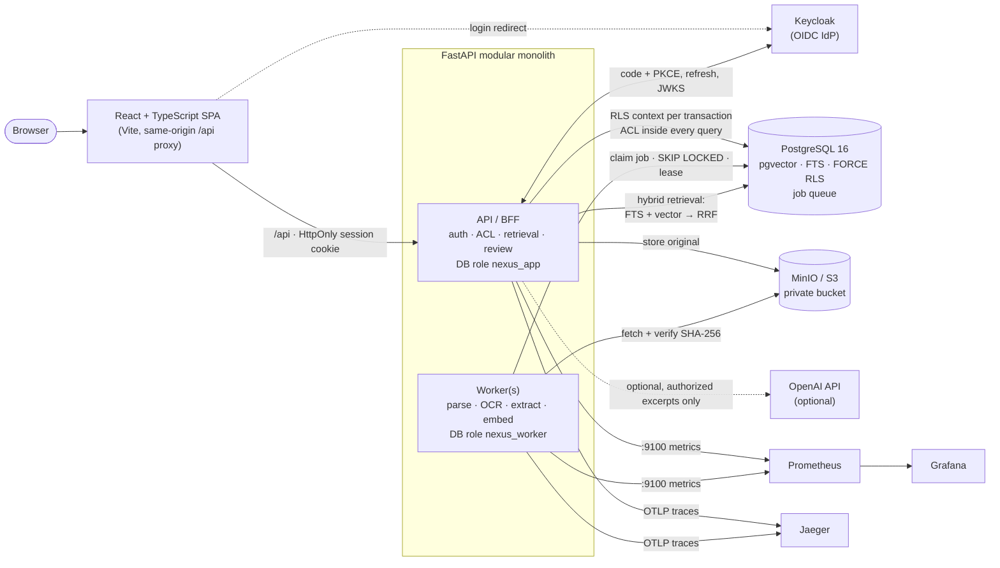
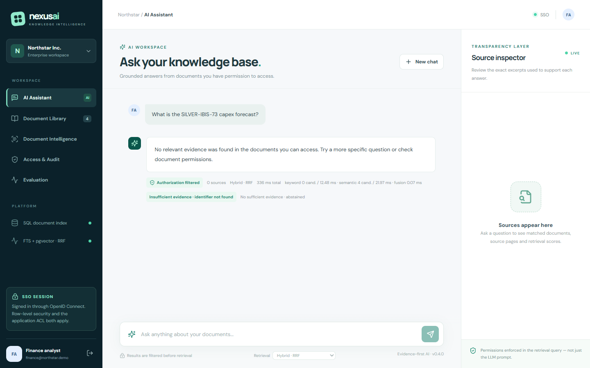
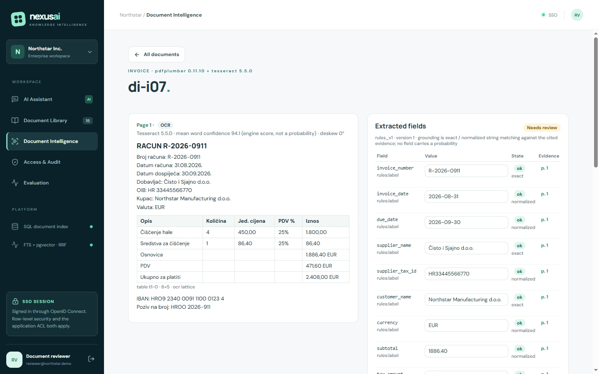
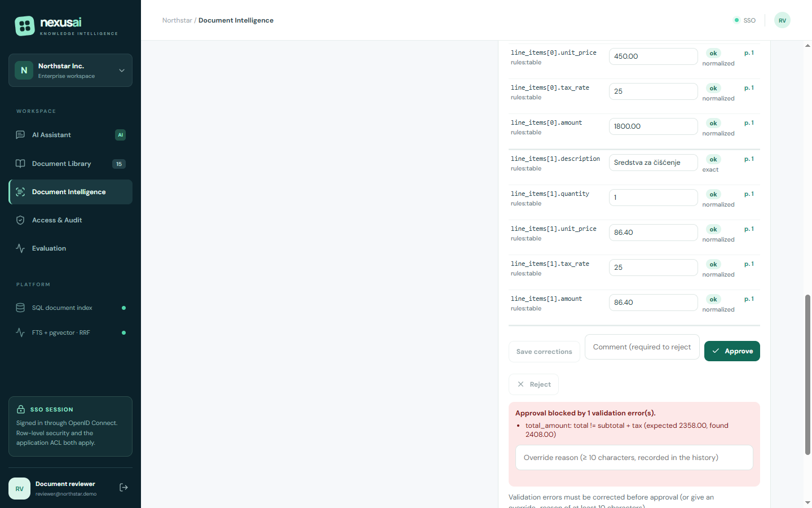
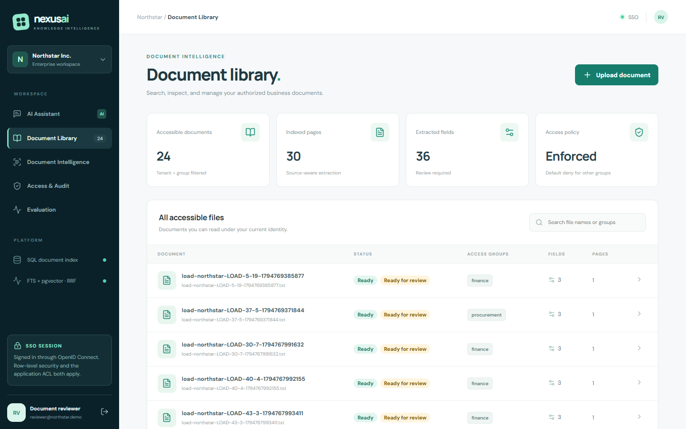
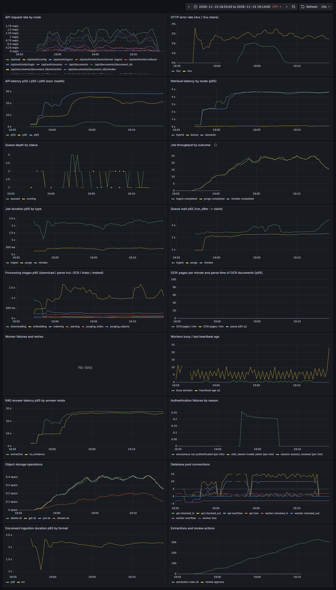

<div align="center">

# NEXUS AI — Enterprise RAG & Document Intelligence

**Permission-aware hybrid retrieval and evidence-grounded document extraction, enforced by PostgreSQL row-level security and measured with held-out evaluation.**

[](https://github.com/KrzakLara/nexus-ai-enterprise-rag/actions/workflows/ci.yml)
[](LICENSE)


[Architecture](docs/architecture.md) · [Demo](docs/DEMO.md) · [Evaluation](docs/EVALUATION_SUMMARY.md) · [Case study](docs/CASE_STUDY.md) · [Security](docs/security-test-results.md) · [Technical reference](docs/TECHNICAL_REFERENCE.md)

</div>

NEXUS AI answers questions over a company's contracts, invoices and policies, and turns invoices
and contracts into reviewed, structured data. Every answer quotes its sources, every extracted
field points to its evidence, and no user can retrieve a document outside their tenant and groups,
which is enforced both in the retrieval SQL and by PostgreSQL row-level security.

> **Status:** v0.4.0 (Phases 1–4) is merged into `main`; CI is green. It is a **portfolio-grade
> system with synthetic data**: hardened and tested, but not externally penetration-tested,
> certified or operated in production. See [Limitations](#limitations).

## The problem

Enterprise document AI fails in predictable ways:

- **Fragmented documents:** text PDFs, scans, Word and Excel files in several languages.
- **Unreliable answers:** retrieval misses exact identifiers or paraphrases, and LLMs fill the gap
  with fluent hallucinations and unverifiable citations.
- **Leaks:** a vector index that ignores permissions returns another department's or customer's
  text, often straight into an LLM prompt.
- **Manual extraction:** invoice and contract fields are re-typed, and arithmetic errors slip
  through.
- **No audit or operability:** nobody can say who saw what, why a value was accepted, or what
  happens when a worker crashes mid-document.

## The solution

| Problem | How NEXUS AI handles it |
|---|---|
| Mixed formats and scans | One layout-aware parser for text / scanned / mixed PDF, DOCX, XLSX, TXT and Markdown; Tesseract OCR (EN + HR) with deskew and table-lattice reconstruction |
| Missed matches | Four retrieval modes: BM25 baseline, PostgreSQL full-text, pgvector semantic search and **hybrid Reciprocal Rank Fusion** |
| Hallucinations | Answers quote verbatim sentences with `[S#]` citations; a dev-calibrated **evidence policy abstains** when support is insufficient; LLM output with unverifiable citations is discarded |
| Leaks | The ACL is **inside every retrieval statement** before `ORDER BY … LIMIT`; **PostgreSQL FORCE RLS** enforces the same rule a second time for the runtime roles |
| Manual extraction | Pydantic schemas for contracts and invoices; every field carries verbatim evidence (page, line, table cell); Decimal validation flags errors instead of fixing them |
| Trust and audit | **Human review** with corrections, approve / reject, override reasons, optimistic locking and an append-only history; audit events for views, downloads and questions |
| Operations | **OIDC SSO** (Keycloak) through a backend-for-frontend, **durable PostgreSQL job queue** with workers, **S3-compatible storage** (MinIO), **Prometheus / Grafana / OpenTelemetry** |

## Key features

Each feature below is implemented on `main` and covered by tests; links point to the design notes.

| Area | Implemented |
|---|---|
| **Hybrid retrieval** | PostgreSQL FTS (`tsvector` + GIN, `ts_rank_cd`), pgvector exact cosine search over `multilingual-e5-small` embeddings, Python BM25 baseline, **RRF** fusion `Σ wᵢ / (60 + rankᵢ)` with per-branch diagnostics ([ADR-008/009](docs/architecture.md)) |
| **Grounded answers** | Query-aware verbatim extractive answers with `[S#]` citations resolved to the stored chunk and page; optional OpenAI path with citation validation and an explicit fallback |
| **Abstention** | Exact-identifier check + sentence-level cosine threshold (0.835) chosen on the dev split; `no_evidence` / `identifier_not_found` instead of a guess |
| **Multi-tenant access control** | Tenant / group / owner / admin rule in SQL, **PostgreSQL RLS** (FORCE, 15 tables, runtime roles without `BYPASSRLS`, transaction-local context, worker job scope) ([postgresql-rls.md](docs/postgresql-rls.md)) |
| **Authentication** | OIDC Authorization Code + PKCE through a BFF, HttpOnly cookie sessions, CSRF, strict JWT validation with JWKS rotation, back-channel logout ([authentication-oidc.md](docs/authentication-oidc.md)) |
| **Document extraction and OCR** | Layout-aware structure (pages, headings, tables, bounding boxes), Tesseract 5 with deskew and lattice tables ([document-intelligence.md](docs/document-intelligence.md)) |
| **Structured extraction** | Contract and invoice schemas, classification with explicit uncertainty, grounding of every value, Decimal business validation (totals, tax, IBAN checksum, dates) |
| **Human-in-the-loop review** | Corrections beside original values, approval blocked by validation errors unless an override reason is recorded, HTTP 409 on concurrent edits ([human-review.md](docs/human-review.md)) |
| **Durable background processing** | PostgreSQL queue with `SKIP LOCKED`, leases, fencing tokens, retries with backoff, dead letter, crash recovery, idempotency keys ([background-processing.md](docs/background-processing.md)) |
| **Object storage** | S3 / MinIO private bucket, server-generated keys, SHA-256 verification, versions, staged deletion + purge, retention ([object-storage-lifecycle.md](docs/object-storage-lifecycle.md)) |
| **Observability** | Redacted JSON logs, low-cardinality Prometheus metrics, OpenTelemetry traces that cross the queue (API → worker), provisioned Grafana dashboard, alert rules ([observability.md](docs/observability.md)) |
| **Verification** | 567 automated tests, retrieval and extraction CI gates, security regression suite, Docker E2E, failure injection, backup / restore drill, k6 load profiles |

## Architecture



Detailed component and data-flow description, ADRs and trade-offs: [docs/architecture.md](docs/architecture.md).

## Demonstration

Real screenshots from the local Docker stack (Keycloak SSO, queue mode, MinIO, synthetic data),
captured with a headless browser on 2026-11-15 and 2026-11-17.

| Hybrid answer with citations and branch ranks | Cross-tenant identifier refused |
|---|---|
| ![Hybrid answer with verbatim quotes, [S#] citations and keyword / semantic / RRF ranks](docs/images/ui-assistant-hybrid-citations.png) |  |
| **OCR'd scanned invoice with field evidence** | **Approval blocked by validation** |
|  |  |
| **Background processing status** | **Grafana operations dashboard (k6 load window)** |
|  |  |

Step-by-step walk-through, demo accounts and a 2–3 minute video script: **[docs/DEMO.md](docs/DEMO.md)**.
No demo video has been recorded yet.

## Evaluation results

Strongest verified results (methodology, versions and caveats: [docs/EVALUATION_SUMMARY.md](docs/EVALUATION_SUMMARY.md)):

| What | Result | Measured on |
|---|---|---|
| Authorization violations | **0** — 400 retrieval runs, 400 API responses, 396 LLM prompts (Phase 2); 1,946 document-intelligence requests (Phase 3); 4,048 requests under k6 load (Phase 4) | synthetic two-tenant corpora |
| Extraction field-level F1 (held-out test) | **0.971** (all documents 0.985; 376 field slots; 0 of 9 absent fields invented) | 32 synthetic contracts / invoices incl. 7 scans, offline rules provider |
| OCR (10 scanned pages) | CER **0.0015**, key-token recall 0.992 | Tesseract 5.5.0 with deskew + lattice tables |
| Abstention on unanswerable questions | **9/9** refused; 8/41 answerable questions also refused (documented trade-off) | 100-question set, test split |
| Docker end-to-end | **22/22** (SSO → upload → worker → review → RLS → denial → trace → purge → logout) | fresh stack from `main`, 2026-11-17 |
| Failure injection / backup-restore | **12/12** / **8/8** | local Docker drills |
| Test suite | **567 tests**, 0 failures in CI, coverage floor 90 % | GitHub Actions with PostgreSQL, MinIO, Keycloak, Tesseract |

Retrieval quality (generated from the stored report; hybrid is **not** significantly better than the
other modes on this corpus — every paired bootstrap CI contains 0):

<!-- BENCHMARK:START -->
Measured by `scripts/evaluate.py` on 2026-11-12 — 100 labeled questions over 30 synthetic documents (59 chunks); held-out **test split** (50 questions), answerable cases only.

| Mode | Recall@1 | Recall@5 | Recall@10 | Precision@5 | MRR@10 | nDCG@5 | Hit@5 | p50 ms | p95 ms |
|---|---|---|---|---|---|---|---|---|---|
| BM25 (Python baseline) | 0.508 | 0.760 | 0.829 | 0.205 | 0.709 | 0.701 | 0.780 | 6.4 | 9.9 |
| PostgreSQL FTS | 0.557 | 0.797 | 0.817 | 0.210 | 0.732 | 0.738 | 0.829 | 3.7 | 6.4 |
| Semantic (pgvector) | 0.508 | 0.850 | 0.927 | 0.220 | 0.720 | 0.737 | 0.878 | 40.3 | 56.3 |
| Hybrid RRF | 0.545 | 0.809 | 0.902 | 0.215 | 0.730 | 0.734 | 0.829 | 47.1 | 72.2 |

Hybrid evidence policy (identifier rule, sentence cos ≥ 0.835; chosen on dev) on test: answerable recall 0.805, unanswerable detection 1.000, answerability precision 1.000 (Phase 2c policy: 0.854 / 0.778).
Offline answer fact recall on test (hybrid top-5): 0.333 (Phase 2c, first 330 chars) → 0.590 (query-aware quotes).
Authorization violations: 0 (retrieval candidates, API sources, citations, LLM prompts, forbidden text in output).
Full results: [docs/benchmark-results.md](docs/benchmark-results.md).
<!-- BENCHMARK:END -->

Answers and extractions above come from the **offline, deterministic** path. The optional LLM
paths are tested against fake clients only; live LLM quality is not measured.

## Technology stack

| Layer | Technologies |
|---|---|
| Backend | Python 3.12, FastAPI, SQLAlchemy 2, Alembic, Pydantic v2, uv (locked) |
| AI / retrieval | `intfloat/multilingual-e5-small` (SentenceTransformers, CPU), pgvector, PostgreSQL FTS, BM25, RRF, optional OpenAI Responses API |
| Document intelligence | pdfplumber, pypdfium2, Tesseract 5 (`eng+hrv`), python-docx, openpyxl, rule-based extraction, optional LLM provider |
| Database | PostgreSQL 16 + pgvector, row-level security, SQLite for lightweight tests |
| Frontend | React 19, TypeScript 5.7, Vite |
| Security | Keycloak 26 (OIDC, PKCE), BFF cookie sessions, CSRF, RLS, gitleaks |
| Infrastructure | Docker Compose, MinIO (S3 API), PostgreSQL-backed job queue |
| Observability | Prometheus 3.5, Grafana 12.1, OpenTelemetry → Jaeger 2.10, JSON logs |
| Testing | pytest (567 tests), coverage gate, retrieval / extraction CI gates, k6, failure-injection and backup / restore scripts, GitHub Actions |

## Quick start

Prerequisites: Docker Desktop with Compose v2, ~8 GB RAM for the full stack, ~6 GB disk. No API
key is needed.

```bash
git clone https://github.com/KrzakLara/nexus-ai-enterprise-rag.git
cd nexus-ai-enterprise-rag

# Full stack: app + Keycloak SSO + Prometheus / Grafana / Jaeger
docker compose -f compose.yaml -f compose.oidc.yaml -f compose.observability.yaml up --build -d

curl -s localhost:8000/api/health/ready     # wait for "status":"ready"
```

Verified on 2026-11-17 from a clean Compose project: all services healthy in ~2.5 min on a warm
Docker build cache; the first start also downloads the ~470 MB embedding model.

| URL | What |
|---|---|
| http://localhost:5173 | App → **Sign in with SSO** |
| http://localhost:8000/docs | API (OpenAPI) |
| http://localhost:3001 | Grafana (local default credentials in `compose.observability.yaml`) |
| http://localhost:9090 · http://localhost:16686 | Prometheus · Jaeger |

Synthetic accounts (local only), password `DemoPass123!`: `finance@northstar.demo`,
`hr@northstar.demo`, `reviewer@northstar.demo`, `admin@northstar.demo`, `finance@otherco.demo`
(other tenant). `docker compose up --build` alone starts the simpler demo-login mode.
Running without Docker, tests and evaluation commands: [docs/TECHNICAL_REFERENCE.md](docs/TECHNICAL_REFERENCE.md).

## Security

- **Defense in depth for data access:** application ACL inside every retrieval statement
  (no global top-k followed by filtering) **and** PostgreSQL FORCE RLS for the runtime roles. A
  mutation test removes the application filter and shows RLS still blocks the leak.
- **No tokens in the browser:** OIDC through a backend-for-frontend; HttpOnly `__Host-` cookies,
  CSRF tokens and Origin checks; strict JWT validation (algorithm allowlist, JWKS rotation).
- **AI-specific controls:** only authorized text can enter an LLM prompt; retrieved text is framed
  as untrusted data; unknown citations discard the model output; identical 404s prevent
  document-ID probing.
- **Storage:** private bucket, server-generated keys, content sniffing, zip-bomb limits,
  `attachment` + `nosniff` downloads.
- **Fail-closed configuration:** demo login, insecure cookies and privileged DB roles are refused
  when `APP_ENV` is staging or production.

Threat model and results: [docs/security.md](docs/security.md), [docs/security-test-results.md](docs/security-test-results.md).

## Engineering decisions

| Decision | Trade-off |
|---|---|
| ACL **inside** the SQL of every retrieval branch | No reuse of a shared global index or cache; in return no unauthorized chunk ever reaches ranking, fusion, logs or a prompt |
| Exact vector scan, **no ANN index** | Linear cost per authorized chunk; avoids the recall loss of post-filtered ANN for small tenants. ANN needs a per-tenant recall benchmark first |
| RRF instead of score blending | Rank-based, no score calibration across BM25 / cosine; the RRF score is reported as a rank statistic, not a confidence |
| Abstain below a dev-calibrated threshold | Refuses all unanswerable test questions but also 8/41 answerable ones; the trade-off is published |
| RLS as a second enforcement | +10–20 ms per retrieval query for group members on this corpus; a forgotten filter can no longer leak |
| Job queue in PostgreSQL | Job row committed in the same transaction as the upload (no outbox); throughput bounded by PostgreSQL, adequate at this scale |
| Deterministic rules before LLM extraction | Reproducible, auditable, offline; lower coverage of novel labels (all misses are of that kind) |
| Modular monolith | One deployable, one ACL and one audit trail; workers scale separately via `--scale worker=N` |

More: [docs/architecture.md](docs/architecture.md) (ADRs) and [docs/CASE_STUDY.md](docs/CASE_STUDY.md).

## Limitations

- **Portfolio project, synthetic data.** No real customer, enterprise deployment or production
  traffic. Metrics are optimistic compared with real documents.
- **No live LLM evaluation.** The OpenAI answer path and the LLM extraction provider are verified
  only with fake clients.
- **Retrieval scale:** exact vector scan without ANN, no reranker, `simple` FTS configuration
  without stemming; cross-language questions remain the weakest category.
- **Not externally validated:** no penetration test, no compliance certification, no HA /
  multi-region, no WAF / edge rate limiting, no KMS for the session key.
- **Load results are from one laptop** (one API, one worker, CPU embeddings) and are not capacity
  claims.

## Repository guide

| Path | Contents |
|---|---|
| `backend/app/` | FastAPI app: retrieval, fusion, evidence policy, `docintel/`, `identity/`, `jobs/`, `observability/` |
| `backend/tests/` | 567 tests |
| `backend/migrations/` | Alembic revisions 0001–0008 (pgvector, FTS, document intelligence, identity, storage, jobs, RLS) |
| `frontend/` | React + TypeScript SPA |
| `eval/` | Frozen datasets, reports and Phase 4 / Phase 5 run evidence |
| `scripts/` | Seeding, evaluation, E2E, drills, load-test runner |
| `docs/` | Architecture, demo, evaluation, security, operations, case studies, releases |

## License

NEXUS AI's own code is released under the [MIT License](LICENSE), Copyright (c) 2026 Lara Krzak.
Third-party components, fonts embedded in the evaluation PDFs, the embedding model and Docker
image contents keep their own licenses: see [THIRD_PARTY_NOTICES.md](THIRD_PARTY_NOTICES.md).

All companies, people and document contents are fictional. Do not deploy this demo publicly or use
it with real confidential material.
