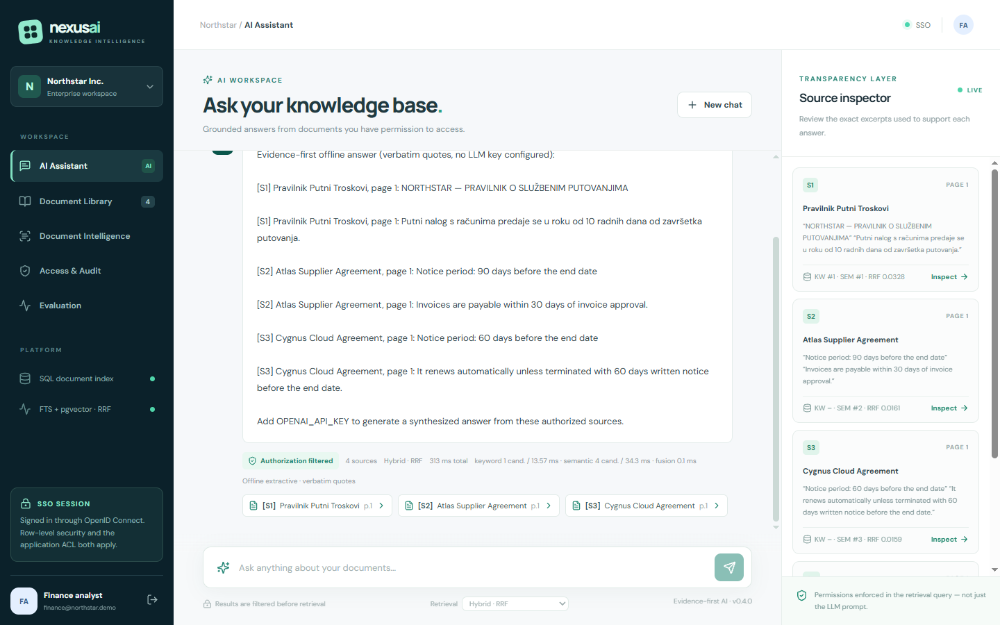
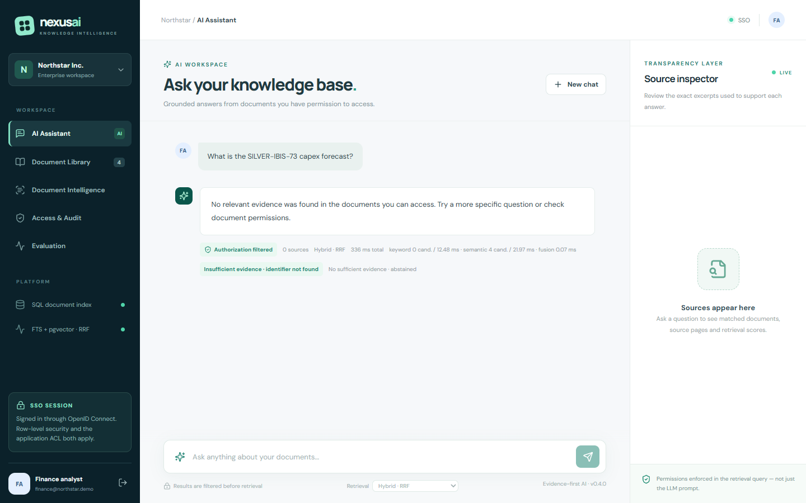
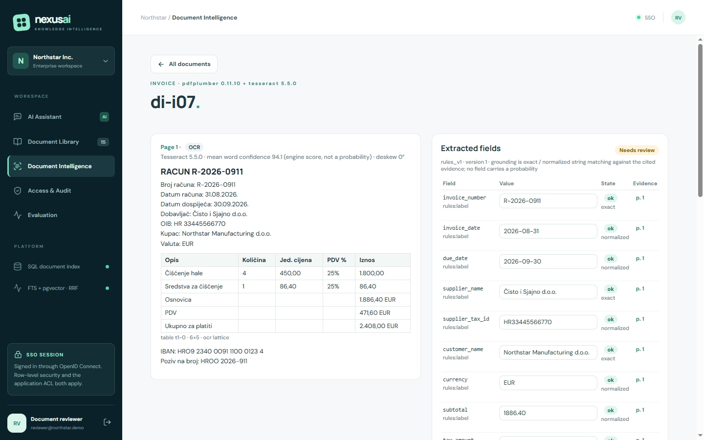
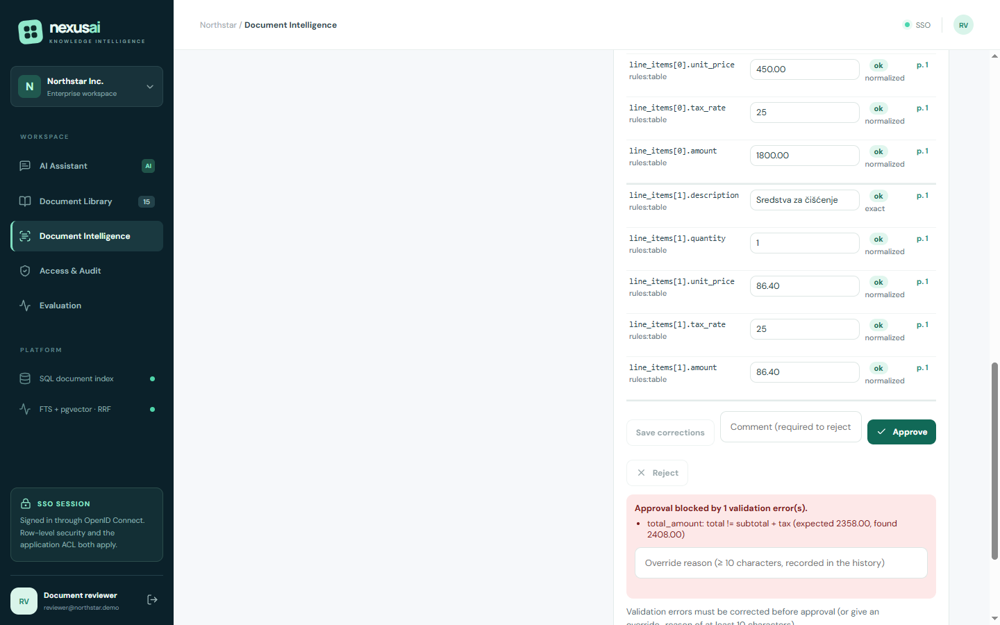
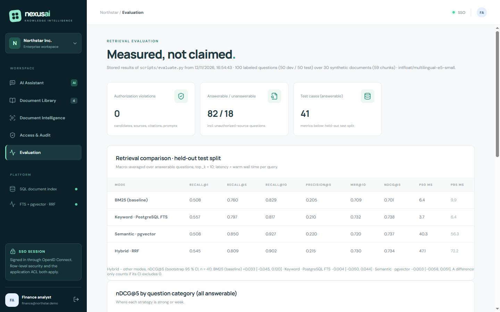
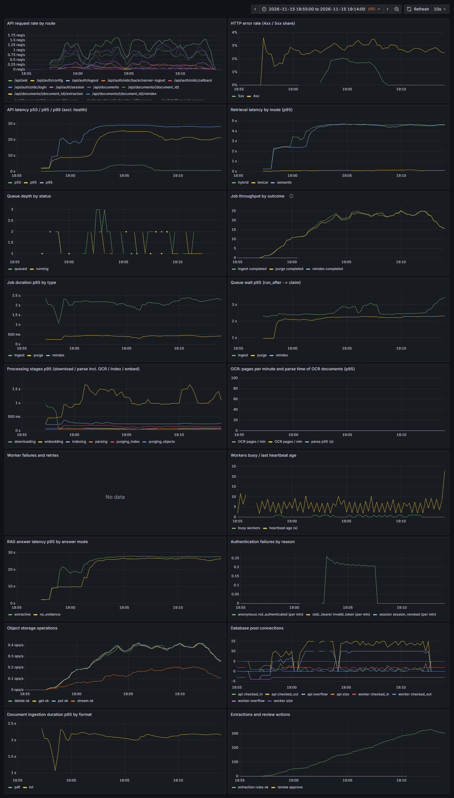

# NEXUS AI demo (v0.4.0)

A practical walk-through for showing NEXUS AI to a reviewer or recording a short video. Everything
runs locally with Docker, without an API key. All companies, people and documents are fictional
and generated for this project.

Every step below was performed on 2026-11-17 against a stack started from `main` with the
commands in section 2 (headless Chromium through Keycloak SSO). Expected results are what was
observed then. The screenshots in [`docs/images/`](images/) come from these runs.

## 1. Prerequisites

| Requirement | Notes |
|---|---|
| Docker Desktop with Compose v2 | ~8 GB RAM available to Docker for the full stack, ~6 GB disk |
| Free local ports | 5173 (app), 8000 (API), 8080 (Keycloak), 3001 (Grafana), 9090 (Prometheus), 16686 (Jaeger), 5433 (PostgreSQL); all bound to 127.0.0.1 |
| Internet on first start | to pull images and download the ~470 MB embedding model into a Docker volume |
| No API key | answers are verbatim extractive quotes; see "Optional: LLM answers" below |

## 2. Start the stack

```bash
docker compose -f compose.yaml -f compose.oidc.yaml -f compose.observability.yaml up --build -d
curl -s localhost:8000/api/health/ready
```

Expected: after ~2–4 minutes (longer on the very first build),

```json
{"status":"ready","checks":{"database":"ok","schema":"ok","workers":"ok","object_storage":"ok","identity_provider":"ok","embedding_model":"loaded"}}
```

`curl -s localhost:8000/api/health` should report `"auth_mode":"oidc"`, `"processing_mode":"queue"`,
`"storage_backend":"s3"` and `"ocr_available":true`.

The one-shot `migrate` service seeds the synthetic data: 7 Phase 2 documents
([`demo_documents/`](../demo_documents/)) and 11 Phase 3 contracts / invoices from the frozen
evaluation corpus ([`eval/docintel/documents/`](../eval/docintel/documents/)), with embeddings
and extractions.

Stop and remove everything (including the demo volumes) with
`docker compose -f compose.yaml -f compose.oidc.yaml -f compose.observability.yaml down -v`.

**Simpler mode:** `docker compose up --build` starts the app without Keycloak and observability;
the login page then shows one-click demo personas instead of "Sign in with SSO".

## 3. Demo accounts (synthetic, local only)

Password for every account: `DemoPass123!` (defined in the local Keycloak realm
`docker/keycloak/nexus-realm.json` and the demo seed; never use it outside this stack).

| Account | Tenant · groups · role | Use it to show |
|---|---|---|
| `finance@northstar.demo` | Northstar · finance, legal | search, citations, cross-language answer |
| `reviewer@northstar.demo` | Northstar · procurement, finance · reviewer | upload, extraction, review, approval rules |
| `hr@northstar.demo` | Northstar · hr | same-tenant group isolation |
| `admin@northstar.demo` | Northstar · all groups · admin | audit events |
| `finance@otherco.demo` | Otherco · finance | cross-tenant isolation |
| `procurement@northstar.demo` | Northstar · procurement | read-only extractions |

Grafana: http://localhost:3001 with the local defaults `GRAFANA_ADMIN` / `GRAFANA_ADMIN_PASSWORD`
from `compose.observability.yaml` (override them through environment variables).

## 4. Step-by-step demonstration

| # | Capability | Action | Expected result |
|---|---|---|---|
| 1 | **Authentication** | Open http://localhost:5173 → **Sign in with SSO** → Keycloak form → `finance@northstar.demo` | Back in the app with an **SSO SESSION** badge. The browser holds only an HttpOnly cookie (no token in `localStorage`). |
| 2 | **Hybrid search + citations** | AI Assistant → quick prompt **5 · Cross-language (HR → EN)** (*"Koliko dana unaprijed moramo najaviti raskid ugovora s dobavljačem?"*) | Verbatim quotes with `[S1]–[S3]`; the Atlas Supplier Agreement is cited with *"Notice period: 90 days before the end date"*. The source inspector shows the keyword / semantic ranks and the RRF score; the footer shows branch timings and "Authorization filtered".  |
| 3 | **Exact identifier** | Quick prompt **1 · Exact identifier** (`NS-IT-2026-017`, Keyword) | One source, the Cygnus Cloud Agreement, quoted *"Agreement ID: NS-IT-2026-017"*; the inspector shows `KW #1 · ts_rank` (PostgreSQL full-text search). |
| 4 | **Abstention** | Quick prompt **6 · Abstains** | "No relevant evidence…", 0 sources, badge **Insufficient evidence · evidence similarity below threshold**: nothing is cited and nothing would be sent to an LLM. |
| 5 | **Access control (tenant)** | Quick prompt **7 · Blocked** (*"What is the SILVER-IBIS-73 capex forecast?"*, an identifier that exists only in the Otherco tenant) | **Insufficient evidence · identifier not found**, 0 sources, no Otherco text.  |
| 6 | **Document upload** | Sign out; sign in as `reviewer@northstar.demo` → Document Library → **Upload document** → choose [`eval/docintel/documents/di-i02.pdf`](../eval/docintel/documents/di-i02.pdf) (a synthetic Croatian invoice that is not pre-loaded), group `finance` → Upload | The row appears as **Queued**, then **Ready · Ready for review** (≈ 3 s on the test machine). |
| 7 | **Background ingestion** | Open the document (click the row) → **Lifecycle** panel | Version 1 and the processing history (the ingest job with its status and attempts); re-index, new version and delete actions for authorized users. |
| 8 | **Structured extraction + evidence** | Document Intelligence → **di-i02** | Page text with the rebuilt line-item table; invoice fields (number, dates, supplier, OIB, totals, IBAN) each with state, grounding method (`exact` / `normalized`) and an evidence page; status **Awaiting approval**. |
| 9 | **OCR** | Document Intelligence → **di-i07** (scanned invoice) | Page header "OCR · Tesseract 5.5.0 · mean word confidence … · deskew 0°"; table rebuilt from the scan.  |
| 10 | **Human review rules** | In di-i07 click **Approve** | **Approval blocked by 1 validation error**: `total_amount: total != subtotal + tax (expected 2358.00, found 2408.00)`; an override reason (≥ 10 characters) is required and recorded.  |
| 11 | **Review and approval** | Open **di-i02** → **Approve** | "Approved. This extraction is approved. It is final…"; the review history shows `process v1` and `approve v2`. |
| 12 | **Comparison / insights** *(optional; from the Phase 3 walk-through, not re-run on 2026-11-17)* | Select **di-c01** and **di-c09** → **Compare**; **Insights → Conflicts** | The contract and its amendment differ in end date, value and notice period; conflicting supplier IBANs are listed with citations. |
| 13 | **Access control (group / tenant)** | Sign in as `hr@northstar.demo`, then `finance@otherco.demo`: open Document Library and repeat prompt 5 | Otherco's library contains exactly one document (*Otherco Confidential Budget*) and none of the Northstar documents or extractions. HR gets no Atlas text (also checked automatically: E2E step 6). |
| 14 | **Audit** | Sign in as `admin@northstar.demo` → **Access & Audit** | Tenant-scoped audit events, e.g. Login, Upload, Process, Structure View, Extraction View, Logout. |
| 15 | **Evaluation** | **Evaluation** | Stored benchmark from `eval/reports/latest.json`: four modes on the held-out test split, 0 authorization violations, abstention table, RRF ablation.  |
| 16 | **Observability** | Grafana http://localhost:3001 → dashboard *NEXUS AI — Operations*; Jaeger http://localhost:16686 → service `nexus-api` | Request rates, latencies, queue depth and job durations; a trace of the upload that continues into `nexus-worker` spans.  |

Notes:

- Uploading the same file again creates a second document; the API reports the earlier copy in
  `duplicate_of`. Use a fresh stack for a clean demo.
- The Grafana screenshot above was taken during the Phase 4 k6 load test; a freshly started demo
  stack shows much less traffic.
- Step 11 changes data. Use a disposable stack (`down -v` afterwards) if you need to repeat the demo.

## 5. Automated checks for the same flow

| Command | What it proves |
|---|---|
| `python scripts/e2e_phase4.py --project <compose-project> --report <file>` | 22 checks: OIDC + PKCE login, upload → worker → hybrid answer, reviewer approval, RLS on the live DB, other group / tenant denied, metrics, logs, one trace across API and worker, re-index, delete + purge, RP-initiated and back-channel logout. It writes data: run it against a disposable Compose project (`-p <name>`). Result on 2026-11-17: [22/22](../eval/phase5/e2e-phase5-main.json). |
| `python scripts/demo_scenarios.py` | The retrieval demo scenarios through demo login (simpler mode, `docker compose up --build`). |

Run the scripts from a Python environment with the project dependencies (`uv sync --locked --extra dev`).

## 6. Troubleshooting

| Symptom | Cause / fix |
|---|---|
| `/api/health/ready` reports `embedding_model` not loaded | First start is still downloading the model; wait and retry. Semantic / hybrid search answer HTTP 503 until it is loaded. |
| Keycloak login page does not load | Keycloak takes 30–60 s to import the realm; `docker compose ps` must show `keycloak` as healthy. Port 8080 must be free. |
| "Sign in with SSO" is missing, persona buttons appear | The stack was started without `compose.oidc.yaml` (demo mode). |
| A document stays **Queued** | `docker compose ps worker`; `docker compose logs worker`. Jobs are durable: a restarted worker picks them up. |
| Upload rejected with 413 / 415 / 422 | Size limit, unsupported or mismatched file type, or a malformed file (by design). |
| Port already in use | Stop the other service or change the published port in a Compose override. |
| Grafana dashboard is empty | Traffic is needed: ask a few questions; Prometheus scrapes every few seconds. |
| Everything is slow | CPU embeddings and OCR; give Docker more CPUs. Load results: [performance-benchmarks.md](performance-benchmarks.md). |

## 7. Video script (2–3 minutes)

A recorded demo is available: [`docs/videos/nexus-ai-demo.mp4`](videos/nexus-ai-demo.mp4)
(2:25, 1920 × 1080, H.264, no audio; English on-screen captions). It was recorded on 2026-11-17 by
[`scripts/demo_video/`](../scripts/demo_video/) (Playwright + Chrome DevTools screencast against a
fresh stack, edited with FFmpeg). It uses two synthetic **English** demo invoices from
[`demo_documents/video/`](../demo_documents/video/), which are generated by the same generator as the evaluation corpus
but are not part of it: a text PDF that is extracted and approved, and a scanned PDF whose total does
not add up. It follows steps 1, 6–8, 10–11, 13, 15 and 16 above with these documents, plus
English questions typed into the assistant. The original
suggested script, using the steps above:

| Time | Screen | Narration (suggested) |
|---|---|---|
| 0:00–0:15 | README header, architecture diagram | "NEXUS AI is a document-intelligence and RAG system where access control is enforced inside retrieval and again by PostgreSQL row-level security." |
| 0:15–0:30 | Step 1: SSO login through Keycloak | "Login is OpenID Connect with PKCE through a backend-for-frontend; the browser never holds a token." |
| 0:30–1:00 | Step 2: cross-language question, source inspector | "A Croatian question finds an English contract. Hybrid retrieval fuses PostgreSQL full-text and pgvector results with Reciprocal Rank Fusion; every sentence is quoted verbatim with its citation and ranks." |
| 1:00–1:15 | Steps 4–5: abstention and cross-tenant identifier | "When evidence is insufficient the system abstains. Another tenant's identifier returns nothing: the ACL is part of the SQL that ranks." |
| 1:15–1:45 | Steps 6–8: upload, live status, extraction | "Uploads go to private object storage and a durable PostgreSQL job queue; a worker parses, OCRs, extracts and embeds. Each field points to its evidence." |
| 1:45–2:15 | Steps 9–10: scanned invoice, approval blocked | "This scanned invoice was OCR'd with deskew and table reconstruction. Its total doesn't add up, so approval is blocked until a reviewer corrects it or records an override." |
| 2:15–2:35 | Step 16: Grafana, Jaeger trace | "Metrics and a single trace follow the upload from the API into the worker." |
| 2:35–2:50 | Step 15: Evaluation view | "Everything is measured on held-out synthetic data: zero authorization violations, and the honest result that hybrid is not significantly better than single modes here." |

Recording tips: 1440 × 900 browser window, sign in before recording each persona, keep the
Keycloak password typing off-camera, and say that the data is synthetic.

## 8. Optional: LLM answers

With `OPENAI_API_KEY` (and optionally `OPENAI_MODEL`) in `.env`, `/api/ask` sends the
**authorized** excerpts to the OpenAI API and accepts the answer only if every `[S#]` citation
resolves to a supplied source; otherwise the verbatim quotes are shown with a notice. This path is
tested against a fake client only; it was **not** used for the demo or any published metric. Do
not use real confidential data.
