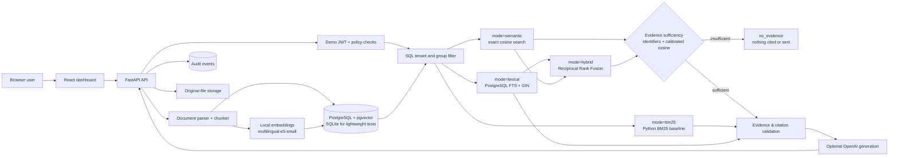
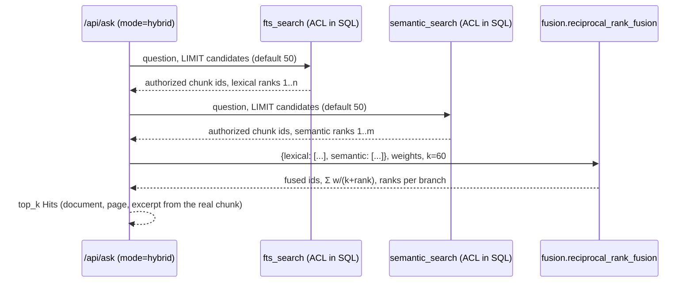
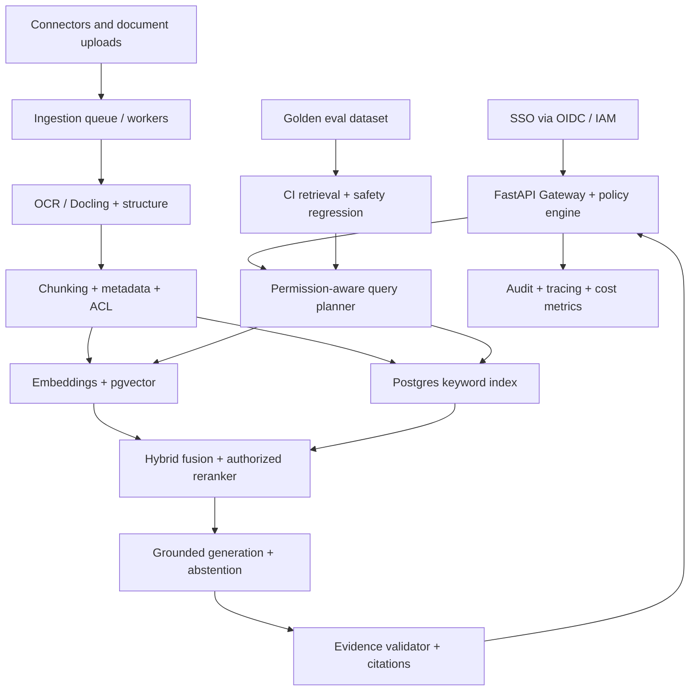

# Architecture and design decisions

**Current release:** v0.2-dev (Phase 2d). This is a runnable **vertical slice** with permission-scoped BM25, PostgreSQL full-text, pgvector semantic and hybrid (RRF) retrieval, query-aware verbatim answers and a dev-calibrated abstention policy, and it is not a production-ready system.

## Context and goals

Enterprise users need answers to business questions and the ability to inspect the original evidence, but must never receive information from documents outside their tenant and permitted group(s).

### System boundaries



Data plane: upload parses documents synchronously and stores a checksum, document metadata, source text chunks, field evidence and a local copy of the original. It then embeds the new chunks with the local model (PostgreSQL only). Retrieval only reads chunks the user is authorized for: the ACL subquery sits in the same SQL statement as BM25 candidate loading or the vector `ORDER BY ... LIMIT k`. In keyless mode, the backend returns annotated source excerpts. With an API key, it calls an LLM with these authorized excerpts and verifies that cited source IDs exist.

Control plane: users have a tenant, an assigned role and a list of groups. A document has an owner, tenant and explicit grants. Visibility = same tenant AND (admin OR owner OR share-group match). A document with no grants is not publicly visible. For security testing, a separate Otherco tenant has a unique budget codename.

## ADR-001: SQL authorization before ranking

Retrieval is implemented as an authorized `Document.id` subquery joined to `Chunk`. Do NOT fetch all documents or index from an unscoped vector store and filter only *after* retrieval; that could expose sensitive chunk text in the model context, logs, errors or reranking provider calls.

### Limitations

This demo filters at the application SQL layer. It does not implement database Row-Level Security, external authorization services, hardened secret handling or a certified compliance boundary. Test the ACL invariants before any semantic-search migration.

## ADR-002: Inspectable lexical baseline first (still the default mode)

The lexical path is still a small in-process BM25 scorer. It caps retrieval at 2,000 authorized chunks, ordered by document ID rather than relevance, and is **not suitable for a large corpus**. PostgreSQL FTS (`tsvector` + GIN) will replace it in v0.2b.

## ADR-005: Exact, permission-scoped vector search before ANN

`retrieval.semantic_search` issues a single statement:

```sql
SELECT chunk, document, embedding <=> :q AS distance
FROM chunks
JOIN chunk_embeddings ON chunk_embeddings.chunk_id = chunks.id AND model_name = :model
JOIN documents ON documents.id = chunks.document_id
WHERE chunks.document_id IN (<authorized_documents(user)>)   -- same ACL as BM25
ORDER BY distance, chunks.id
LIMIT :k
```

There is **no HNSW/IVFFlat index on purpose**. With an ANN index, PostgreSQL can walk the index first and filter afterwards, which loses recall for small tenants or groups (pgvector 0.8 iterative scans reduce this but do not remove the need to measure it). A sequential scan over authorized rows is exact and is fast enough at demo scale (~20 ms warm). Adding ANN is a v0.4 task. It must come with a recall benchmark against this exact baseline, per tenant and group size.

Security test: `test_unauthorized_documents_never_returned_even_when_semantically_closest` first asserts that, *without* the ACL, two forbidden chunks (another tenant, and another group in the same tenant) are the global nearest neighbours. It then asserts that the user only ever receives the authorized chunk for top-k 1, 3 and 10, and also through `/api/ask`. A mutation check that replaced the ACL with an unscoped query made the test fail.

**Known gap:** semantic mode has no similarity threshold, so it always returns up to k authorized chunks even when none of them is relevant, and the "no evidence" abstention only triggers when the user has no embedded chunks at all. E5 cosine scores fall in a narrow band (roughly 0.75-0.85 on the demo corpus), so a threshold must be calibrated on a labeled evaluation set rather than guessed.

## ADR-006: Local embeddings, persisted with provenance

- Model: `intfloat/multilingual-e5-small` (384-d, multilingual, CPU). Documents are encoded as `passage: ...`, queries as `query: ...`, and vectors are L2-normalized, so cosine distance equals 1 - dot product.
- Storage: `chunk_embeddings(chunk_id, model_name)` primary key, `vector(384)`, `model_revision` (Hugging Face commit hash), `embedding_dim` (CHECK = 384), `normalized`, `content_sha256`, `created_at`. Deleting a chunk cascades to its embeddings.
- Idempotency: a chunk is embedded only when it has no row for the configured model or when its `content_sha256` differs from the stored one. Backfill and seeding can be re-run safely.
- No fake vectors: load errors, wrong dimensions, NaN or unnormalized output raise `EmbeddingError`. Upload keeps the document and reports `embedding_status: failed`, and the backfill retries later.
- The model loads lazily in the API process, so the first semantic query after start pays the load time (~10 s measured in Docker with a warm cache).

## ADR-008: PostgreSQL full-text search with the `simple` configuration

Migration `0003` adds `chunks.content_tsv tsvector GENERATED ALWAYS AS (to_tsvector('simple', content)) STORED` and a GIN index. Because the column is generated, inserts and updates keep it in sync and existing rows are populated by the `ALTER`. It is not mapped in the ORM (SQLite has no tsvector) and is excluded from autogenerate comparison.

`retrieval.fts_search` runs one statement:

```sql
SELECT chunk, document, ts_rank_cd(chunks.content_tsv, :tsq, 1) AS rank
FROM chunks JOIN documents ON documents.id = chunks.document_id
WHERE chunks.document_id IN (<authorized_documents(user)>)
  AND chunks.content_tsv @@ :tsq
ORDER BY rank DESC, chunks.id
LIMIT :k
```

Query construction (`build_fts_query_text` + `tsquery_expression`):

1. English and Croatian stop words are removed from **bare** terms. Quoted phrases, `-negations` and identifiers are kept. A question made only of stop words produces no lexical evidence.
2. `websearch_to_tsquery('simple', text)` parses phrases, negation and hyphenated identifiers (`SILVER-IBIS-73` → `'silver-ibis' <-> 'silver' <-> 'ibis' <-> '73'`).
3. `&` is rewritten to `|` (phrases keep `<->`), so natural-language questions need not contain every term. If the query contains a negation (`!`), the AND form is kept, because `a | !b` would match almost every chunk.

Evidence for step 3: on the six answerable demo eval questions, the AND form matched **0/6**, OR without stop-word removal ranked the expected document first for **4/6**, and OR with stop-word removal for **6/6**. This is a small probe without the ACL filter, not a benchmark.

Limitations of `simple`: no stemming (`ugovor` ≠ `ugovora`), no unaccent (`istjece` ≠ `istječe`), and `ts_rank_cd` has no IDF. A Croatian/English-aware configuration (unaccent, a Hunspell dictionary or a custom stop list) is future work and must be measured with the Phase 2c evaluation set.

The BM25 baseline (`mode=bm25`) is kept unchanged, including its 2,000-chunk cap. A test proves that FTS finds a chunk that BM25 misses because of that cap.

## ADR-009: Hybrid retrieval with Reciprocal Rank Fusion



- **Independence:** the two branches are separate SQL statements with their own ranking. Each is permission-scoped, so the fusion input can only contain authorized chunk IDs. A test checks that hybrid output is exactly `reciprocal_rank_fusion` over the standalone `fts_search` and `semantic_search` results.
- **Formula:** `rrf(d) = Σᵢ wᵢ / (k + rankᵢ(d))`, ranks start at 1, and a chunk missing from a branch contributes 0 for that branch. The defaults are `k = 60`, `candidates = 50` per branch and weights `1.0 / 1.0` (env vars or per-request override).
- **Dedup and ties:** dedup is by stable chunk ID (the first occurrence in a branch wins). Ties are ordered by score, then best rank in any branch, then number of agreeing branches, then chunk ID. The live demo produced an exact tie (`kw 2 + sem 1` vs `kw 1 + sem 2` = 0.032522), resolved deterministically.
- **Interpretation:** the RRF score is a rank statistic. Its maximum with two equal-weight branches is 2/61 ≈ 0.0328, and it is not comparable across queries. **It is never presented as confidence or probability**, and the API sends a `score_note` with every response.
- **Failure behaviour:** if the embedding model fails, hybrid returns HTTP 503 rather than silently degrading to keyword-only results. If one branch legitimately returns nothing (for example a Croatian paraphrase with no keyword overlap), the fusion equals the other branch's order.
- **Suppression:** a test inserts 60 other-tenant chunks that fill the *global* lexical top-50. A "global top-N then filter" design would return nothing for the Northstar user. With permission-scoped branches, the authorized Atlas clause is still rank 1, even with `candidates=1`.

**Known gaps:** RRF itself has no relevance threshold; abstention is handled by the separate evidence policy (ADR-010). Croatian queries favour Croatian passages and vice versa (same-language bias of the multilingual model), quantified in [evaluation.md](evaluation.md).

## ADR-010: Evidence-sufficiency policy instead of "always answer"

Up to Phase 2b, semantic and hybrid modes always returned `top_k` authorized chunks, even for questions the corpus cannot answer, or questions about a document the user may not read. `backend/app/evidence.py` adds a policy that runs after permission-scoped retrieval and before citation and prompt construction:

1. **Identifier rule.** Tokens such as `NS-SUP-2026-041`, `SILVER-IBIS-73` or `KESTREL-9` (letters, a hyphen and a digit) must **all** occur as exact tokens in an authorized candidate chunk. `NS-SUP-2026-041` does not match `NS-SUP-2026-041-A1` or `OC-SUP-2026-041`. A missing identifier means `no_evidence` (`identifier_not_found`), which is what stops "tell me about the other tenant's SILVER-IBIS-73" from being answered with unrelated authorized text.
2. **Similarity rule.** Otherwise a cosine similarity must reach a threshold. Phase 2c used the best *chunk* similarity of the semantic branch (τ = 0.82). **Phase 2d uses the best *sentence* similarity** among the query-selected sentences of the top authorized hits (ADR-012), τ = 0.835. The chunk rule is disabled (`EVIDENCE_MIN_SIMILARITY=none`). "Disabled" means the rule is skipped, not a threshold of 0.
3. **Optional rules** (semantic top-1 within the lexical top-3; share of question terms covered by a top hit). Both were evaluated and **not** enabled.

The rule family and τ were selected on the **dev split only** (`scripts/evaluate.py`, maximising balanced accuracy), reported on the held-out test split, and pinned in `eval/calibration.json`. Unit tests fail if the app defaults **or `.env.example`** (parsed with the app's own rules) drift from it. The decision function `decide(signals)` is pure and is shared by the API and the calibration code, so the calibrated behaviour is exactly what ships.

Explicit non-goals: the RRF score is never used (it is a rank statistic), and cosine similarity is reported as a heuristic signal, never as confidence. The measured trade-off of the Phase 2d policy is documented with confusion matrices in [evaluation.md](evaluation.md#evidence-sufficiency-abstention): it detects more unanswerable questions but refuses more answerable ones. The request flag `apply_evidence_policy: false` exposes raw retrieval for inspection.

## ADR-012: Query-aware extractive answers (Phase 2d)

Without an LLM key the offline answer used to print the first 330 characters of each source, which often cut off the fact that retrieval had found. `backend/app/extractive.py` now splits each of the top 3 **authorized** hits into sentences and lines and scores every sentence against the question with `1.0 · cos(e5 query, e5 passage) + 0.5 · share of question content terms` (prefix-stemmed, so Croatian inflections match). The best 2 sentences per source are quoted **verbatim**, in document order, each with its own `[S#]`. Nothing is generated, nothing is merged across sources, and the evaluation checks that every quoted line is a substring of the chunk it cites. The configuration was selected on dev from a 22-configuration grid.

Sentence boundaries are line breaks and `. ` followed by a capital. A **single** line break inside running prose is not a boundary: the next line starts in lower case, or with a number after a line without terminal punctuation. Hard-wrapped TXT and text extracted from PDFs therefore produce whole sentences instead of fragments such as *"Service levels require"*. Headings, `Key: value` lines, numbered items and blank lines stay boundaries. This defect showed up in the live demo, not in the benchmark: the evaluation corpus has 0 mid-sentence line breaks out of 281, while the demo documents have 14 out of 46. `selected_sentences` stays an exact substring of the chunk. The answer text renders each quote on one line with whitespace collapsed, and the evaluation's verbatim check compares up to whitespace only (case, words and punctuation must match).

The same sentence similarities feed the evidence policy (ADR-010), so the sentence that justifies answering is the sentence that is quoted. The API returns them per source as `selected_sentences`, and the source inspector shows them instead of the chunk's opening text. On SQLite (no model) the scorer is lexical only, and if the embedding call fails the API falls back to lexical scoring, which leaves no sentence similarity, so the policy abstains.

## ADR-011: Evaluation harness as part of the product

- Labels are derived from **verbatim evidence quotes in the source documents** and resolved to chunk IDs with the production chunker. Retrieval output is never used for labeling. Authorization-dependent evidence is labeled separately and never counted as relevant.
- The evaluation runs against a dedicated, re-created PostgreSQL database with real persisted embeddings, and verifies the stored rows before measuring. Authorization is checked by an **independent Python ACL oracle**, not by the SQL under test.
- Tuning happens on dev and reporting on test (for both the ablation and the abstention policy). Bootstrap CIs show which differences are real.
- Published numbers (`docs/benchmark-results.md` and the README section) are generated, and a test fails if they are edited by hand. CI runs a deterministic test-split gate with zero tolerance for leaks and citation errors, plus regression floors with a documented margin. Latency is reported but not gated.

See [evaluation.md](evaluation.md) and [security.md](security.md).

## ADR-007: Alembic owns the schema

`Base.metadata.create_all()` is used only by in-memory SQLite unit tests. The API refuses to start unless the database is at the Alembic head. `0001_v01_baseline` reproduces the v0.1 schema exactly. `backend/app/migrate.py` stamps unversioned v0.1 databases at 0001 before upgrading. A test checks that an Alembic-migrated database has no autogenerate diff against the ORM models, on both SQLite and PostgreSQL.

The PostgreSQL tests also exposed a v0.1 bug: without ORM relationships, upload and seeding inserted `chunks` before their parent `documents` row. SQLite did not enforce the foreign key, but PostgreSQL rejected it. Both paths now flush the parent row first.

## ADR-003: Citation evidence must be inspectable

A `Source` contains `document_id`, `chunk_id`, `page`, `excerpt` (the first 800 characters of the real chunk), `selected_sentences` (the verbatim sentences chosen for this question, ADR-012) and the native score of the retrieval mode. In offline mode every quoted line is checked to be a substring of the chunk it cites. LLM answers may reference only the supplied identifiers `[S1]...[Sk]`. Unknown or absent citation markers cause a visible fallback. This is only **format validation**, not factual claim-level verification. A future groundedness evaluator and sentence-to-evidence validation will strengthen it.

Text-only PDFs preserve page numbers. DOCX and TXT are treated as a single logical page in v0.1; exact Word pagination is not reconstructed. Scanned PDF OCR, page bounding boxes, merged cells and spreadsheet tables are future work.

## ADR-004: Local demo authentication is not enterprise SSO

The seed script creates five synthetic users. They log in with a shared demo password and short-lived HS256 JWTs. Only a local network is in scope; Docker binds exposed services to `127.0.0.1`. This is **NOT** production authentication, and **must not be publicly deployed**.

Planned production auth: OIDC Authorization Code + PKCE; validate issuer, audience, signature and session expiry; trusted server-side group mappings; break-glass policies; secret rotation; rate limiting; tenant-scoped RLS where appropriate.

## Threat model and negative tests

| Threat | Control | Test / limitation |
| --- | --- | --- |
| Cross-tenant search leak | `Document.tenant_id == current_user.tenant_id` inside the retrieval statement | Otherco seeded secret; `test_retrieval_cannot_return_cross_tenant_secret` (SQLite + PostgreSQL) |
| Vector-space leak (forbidden chunk is nearest neighbour) | ACL predicate inside `ORDER BY embedding <=> :q LIMIT k`; no post-filtering | `test_unauthorized_documents_never_returned_even_when_semantically_closest` (mutation-checked) |
| Keyword / fusion leak (forbidden chunk is global #1 in FTS and semantic) | ACL inside both branch statements; fusion sees only authorized IDs | `test_unauthorized_chunks_never_appear_in_any_branch_or_fusion` (mutation-checked) |
| Authorized results suppressed by a flood of foreign matches | No global top-N: candidates are drawn per user | `test_globally_dominant_unauthorized_results_do_not_suppress_authorized_ones` |
| Stale permissions | ACL evaluated per query; no retrieval cache | `test_permission_changes_take_effect_immediately` |
| Unauthorized text in LLM context | Prompt built only from returned hits | `test_only_authorized_sources_enter_the_llm_prompt` (all four modes) |
| Unauthorized document view/download | Permission-filtered detail and source handlers | `test_direct_file_routes_do_not_bypass_acl` |
| User elevates a document's share group | Upload checks group membership | `test_cannot_upload_into_unauthorized_group` |
| Source spoofing by LLM | Citation IDs checked against authorized chunks | Format validation only; groundedness not verified |
| Malicious instructions in retrieved content | Prompt treats all source text as data | Prompt-only mitigation is insufficient; red-team tests next |
| Spoofed identity on public network | Docker loopback binding; refuses non-demo mode | Replace auth entirely for real deployment |
| Decompression bombs / hostile Office or PDF | Basic size/page caps | Not sandboxed; parser isolation/scanning planned |

## Target production architecture (planned; not current)



### Next milestones

1. **v0.2a (done):** Alembic, pgvector `vector(384)`, local embeddings, backfill, exact permission-scoped semantic search, PostgreSQL integration tests.
1. **v0.2b (done):** PostgreSQL FTS (`simple`, GIN), hybrid RRF, four API/UI modes with diagnostics, PostgreSQL security tests.
1. **v0.2c (done):** 100-question chunk-level evaluation, four-mode benchmark with CIs, RRF ablation, calibrated evidence-sufficiency policy, citation and security evaluation, CI gates, evaluation UI.
1. **v0.2d (done):** query-aware extractive answers, sentence-level evidence policy, embedder comparison (e5-small kept). Deferred: query translation / expansion, LLM answer evaluation, chunk-size ablation.
2. **v0.3 — document AI:** Docling/OCR, table extraction, layout-aware chunking, Pydantic schema extraction, confidence + human review.
3. **v0.4 — governance:** OIDC, Postgres RLS, signed document links, async jobs, per-tenant observability, source deletion and permission-change reindexing.
4. **v1.0 — engineering evidence:** retrieval and answer eval suite, injection tests, load benchmarks, latency/cost dashboards, threat model and demo video.

## What to measure

- Retrieval: Recall@5, MRR, nDCG@5 on labeled examples, by tenant and access group.
- Answer: citation precision, answer groundedness, abstention rate and correctness (human-labeled).
- Security: zero cross-tenant/group false-allow events; direct download and cached answer scenarios.
- Operations: p50/p95 query latency, ingest throughput, API cost/query, time-to-reindex, document parsing error rate.
