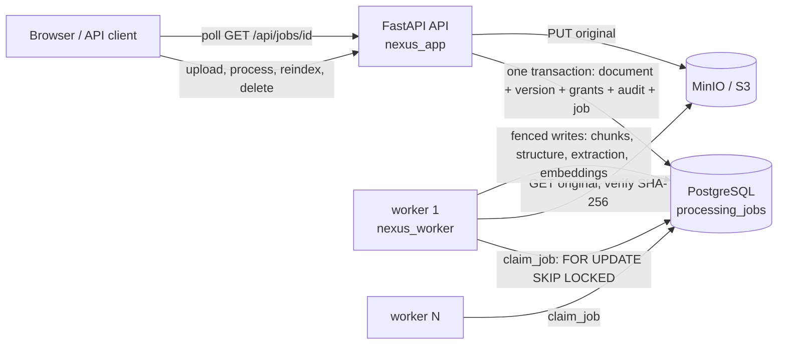
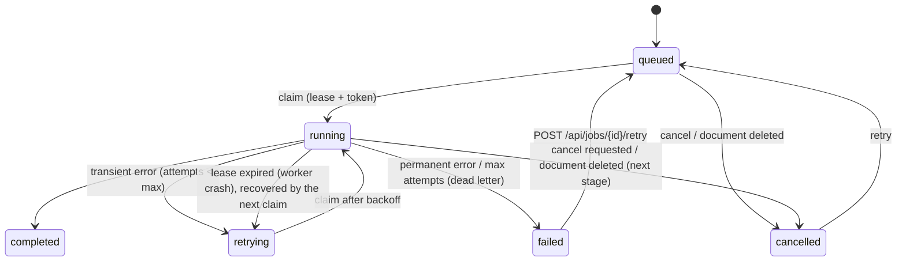

# Background processing (Phase 4C)

## Decision: a PostgreSQL-backed queue

| Criterion | Redis + RQ / Dramatiq | PostgreSQL queue (chosen) |
|---|---|---|
| Atomic with the business write | no: DB commit + broker publish is a dual write; needs a transactional outbox + relay | **yes**: the job row is inserted in the same transaction as the upload / version / delete |
| New infrastructure | Redis (persistence config, auth, backups, HA) | none |
| Durability | depends on Redis AOF / RDB settings | WAL, the same backups as the data |
| Tenant isolation | separate mechanism | row-level security on `processing_jobs` |
| Throughput | very high | sufficient here: claim + complete round trips measured in [performance-benchmarks.md](performance-benchmarks.md) |

The outbox problem ("committed, but the message was never published" or the reverse) disappears:
the outbox **is** the queue. A rolled-back upload never has a job; a committed one always has one.

## Architecture

* API: `PROCESSING_MODE=queue` returns **202** with the job; `inline` (local demo, tests, evaluation
  harnesses) claims the job it just committed and runs the same code in the request, keeping the
  v0.3 response contract (201, `embedding_status`, 422 for unparseable files).
* Worker: `python -m backend.app.worker` (Compose service `worker`, scale with `--scale worker=N`).
  One job at a time per process (parsing, OCR and embedding are CPU-bound and multithreaded inside).

## Job types

| Type | Submitted by | Stages (reported in `stage`) |
|---|---|---|
| `ingest` | upload (v1), new version | downloading → parsing (incl. OCR) → indexing (chunks, structure, rules extraction) → embedding |
| `reprocess` | `POST /api/documents/{id}/process` (owner / reviewer / admin) | [downloading → parsing] → extracting (rules or LLM) |
| `reindex` | `POST /api/documents/{id}/reindex`, `POST /api/admin/reindex` | embedding |
| `purge` | delete, retention expiry | purging_index → purging_objects → tombstone |

`payload` holds identifiers and options only, never document text.

## Lifecycle

* **Claim**: `nexus_rls.claim_job()` (SECURITY DEFINER) first recovers expired leases (worker crash
  → `retrying`, or `failed` on the last attempt, `error_code=lease_expired`), then claims the next
  runnable job with `FOR UPDATE SKIP LOCKED` (two workers never claim the same job), increments
  `attempts` and issues a fresh `lease_token`.
* **Lease / heartbeat**: `JOB_LEASE_SECONDS` (120), extended every `JOB_HEARTBEAT_SECONDS` (20) by a
  heartbeat thread during long OCR / embedding stages; the heartbeat also carries
  `cancel_requested` back to the job.
* **Fencing**: every worker write transaction starts by locking the job row with
  `id = :id AND lease_token = :token AND status = 'running'`; RLS uses the same token. A worker
  that stalled past its lease (or a "zombie" after a network partition) cannot write anything.
* **Retry policy**: exponential backoff with equal jitter, `base · 2^(attempt-1)` capped at
  `JOB_BACKOFF_MAX_SECONDS`, uniformly in [50 %, 100 %]; `JOB_MAX_ATTEMPTS` (5).
* **Error classes**: transient (retry) — `storage_unavailable`, `object_missing`,
  `embedding_unavailable`, `database_unavailable`, `internal_error`, `lease_expired`; permanent
  (dead letter at once) — `parse_failed`, `unsupported_format`, `checksum_mismatch`,
  `authorization_revoked`, `extraction_locked`, `extraction_provider_failed` (no silent LLM retries,
  "no fallback" contract), `not_deleted`, `database_permission_denied`. Messages are fixed texts or
  our parser's own messages; third-party exceptions contribute their type name only.
* **Idempotency**: `Idempotency-Key` header on uploads (unique per tenant); one active `reindex` /
  `ingest` per document (duplicates return the existing job). The check-and-enqueue is atomic on
  PostgreSQL: transaction-scoped advisory locks (per document; a tenant-wide re-index takes one
  tenant lock) make concurrent duplicate submissions wait for each other. The resilience drill
  found the race (two simultaneous requests created two jobs); a mutation test shows the test
  fails without the lock. Deterministic chunk ids
  (`uuid5(document, version, page, position)`), unchanged chunks keep their embeddings, embeddings
  keyed by `(chunk, model)` with content hashes, extraction is an upsert, and a `checkpoint` in
  `job.result` resumes an ingest after the indexing stage (no duplicate extraction events on retry).
* **Worker restart**: SIGTERM stops claiming, finishes the current job (`stop_grace_period: 60s`);
  SIGKILL leaves the lease to expire and the job is recovered by any worker.

## Worker security

The worker connects as `nexus_worker` and every transaction carries the job's RLS scope: it can read
and write only the document of the job whose lease it holds ([postgresql-rls.md](postgresql-rls.md)).
User-submitted jobs re-check the submitter's current access before writing. Job types are a fixed
allowlist dispatched to code in this repository (no user-supplied callables, no pickled payloads);
document contents are parsed as data and never executed. Logs and job errors contain identifiers
and categories only.

## API

| Endpoint | Purpose |
|---|---|
| `GET /api/jobs?status=&document_id=` | own jobs, jobs of readable documents (admins: tenant) |
| `GET /api/jobs/{id}` | status, stage, attempts, error category / message, result counts, timestamps |
| `POST /api/jobs/{id}/retry` | failed or cancelled → queued with a fresh attempt budget (submitter / admin) |
| `POST /api/jobs/{id}/cancel` | queued → cancelled at once; running → cancel requested (purge jobs cannot be cancelled) |
| `GET /api/documents/{id}/jobs` | processing history of a document |

The frontend polls `GET /api/documents` every 2 s while a document is queued / processing and shows
the real stage names ("Parsing / OCR", "Embedding", "Retrying (attempt 2 of 5) · storage
unavailable", "Failed · parse failed" + Retry, "Ready for review"); no percentages are estimated.

## Verification

`test_jobs_lifecycle.py` (real Worker loop, SQLite + PostgreSQL with RLS): queue mode 202 → worker →
searchable; idempotency keys; duplicate reindex dedupe; storage outage → retry with backoff →
success; parse failure → dead letter → retry; max attempts; embedding outage keeps keyword search
and resumes at the checkpoint without duplicate extraction; crashed worker lease recovery + fenced
zombie; document deleted while queued; permission revoked before execution; cancellation; worker
heartbeat in readiness; backoff bounds. `test_rls_pg.py::test_claims_are_exclusive_under_concurrency`
(6 threads, 12 jobs, every job exactly once). Docker: `scripts/resilience_drill.py` (SIGKILL during
OCR, two workers with duplicate submissions, deletion during processing).
