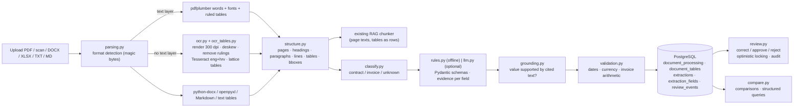

# Document intelligence (Phase 3)

NEXUS AI turns contracts and invoices into **structured, evidence-backed, reviewable data**, next to the hybrid RAG of Phase 2. Everything runs locally on CPU, without an API key. An LLM provider is optional and off by default.

This is a **local demo, not production-ready**. Measured results are in [extraction-evaluation-results.md](extraction-evaluation-results.md) (generated) and the methodology in [extraction-evaluation.md](extraction-evaluation.md).

## Architecture: a modular monolith

| Module | Responsibility |
|---|---|
| `backend/app/docintel/parsing.py` | Format detection by extension **and** magic bytes. Layout-aware parsing into one normalized structure. OCR decision per page. |
| `ocr.py`, `ocr_tables.py` | Tesseract 5 (English + Croatian) on 300-dpi renders. Steps: projection-profile deskew, ruling-line detection and removal, lattice table rebuild with merged cells. |
| `structure.py` | `ParsedDocument → Page → Block (heading / paragraph / table) → Line / Cell`, with bounding boxes **only when the parser produced them** |
| `classify.py` | Weighted EN/HR cue phrases. Returns `unknown` with `ambiguous` or `insufficient_evidence` instead of forcing a class. |
| `schemas.py` | Pydantic v2 `ContractExtraction`, `InvoiceExtraction`, `LineItem` and `ExtractedField` (value, raw, evidence, method, grounding, issues). Canonical value formats are enforced. |
| `rules.py` | Offline deterministic provider: label, table and sentence rules. |
| `llm.py` | Optional OpenAI provider with a strict JSON schema. Every value must be quoted from the document and is re-grounded. Failures raise an error, with no fallback. |
| `grounding.py` | Checks that evidence comes from the right document, a valid page, text on that page and the right table cell, and that the value is supported by it. |
| `validation.py` | Field-level business rules on Decimal values with ROUND_HALF_UP rounding. Nothing is auto-corrected. |
| `service.py` | Pipeline, persistence, idempotent re-processing, failure states |
| `review.py` | Review lifecycle, reviewer role, optimistic concurrency, audit |
| `compare.py` | Multi-document comparison, structured queries, EN/HR question router |
| `backend/app/docintel_api.py` | HTTP API. All routes are sync `def`, so FastAPI runs them in its threadpool. |

### Why not Docling (yet)

Docling was evaluated as the primary parser. Resolved against this project's pins, it adds **110 packages**, including torchvision, OpenCV, RapidOCR, transformers 5.x and accelerate, and it downloads layout and TableFormer models on first use. The chosen stack (pdfplumber, pypdfium2, Pillow, openpyxl, pytesseract plus the Tesseract binary) adds about 12 small packages and needs no model download. The parser sits behind one function (`parse_document`), so Docling remains a drop-in candidate if layout quality on real-world documents requires it.

## Supported formats

| Format | Parser | Pages | Bounding boxes | Tables |
|---|---|---|---|---|
| PDF with a text layer | pdfplumber words (font size and weight) | real pages | yes (PDF points, top-left origin) | ruled tables (cell boxes, merged cells). Unruled tables are rebuilt from a recognised header row. |
| Scanned PDF | pypdfium2 render at 300 dpi + Tesseract `eng+hrv` | real pages | yes, on the **deskewed** raster, converted to points | ruling-line lattice, merged cells from missing borders |
| Mixed PDF | per page: text layer or OCR | real pages | as above | as above |
| DOCX | python-docx, body in document order | **one logical page** (DOCX has no fixed pagination) | none (never invented) | yes, merged cells from shared `w:tc` |
| XLSX | openpyxl (cached values) | one page per worksheet | none | header-recognised blocks; merged ranges. A formula without a cached value is reported as a warning, never computed. |
| TXT | text, `\f` = page break | per `\f` | none | aligned columns under a recognised header |
| Markdown | `#` headings, pipe tables | one | none | pipe tables |

Malformed files fail with HTTP 422 and a reason. This covers truncated PDFs, corrupt ZIPs, a DOCX that is really an XLSX and non-UTF-8 text. Unsupported extensions get HTTP 415. A PDF page with no text layer is OCRed; if OCR is unavailable, the upload fails with *"Page N needs OCR"* rather than silently indexing an empty page.

**Provenance is preserved.** Page texts from the new parser feed the **existing RAG chunker unchanged**. For the existing PDF fixtures they are byte-identical to the v0.2 text, so Phase 2 chunk IDs, page numbers and citations keep their meaning. Tables enter the chunks row by row (`Description | Qty | ...`), so table content is searchable by BM25, FTS, semantic and hybrid retrieval.

## Extraction schemas

Every field is an `ExtractedField` with:
- `value`, canonical or `null`;
- `raw`, the surface text;
- `evidence`, which records the document, page, the verbatim line, row or sentence, the block, the bbox when available, and the table, row and column;
- `method` (`rules:label`, `rules:table`, `rules:sentence`, `rules:title_keywords`, `llm:<model>`);
- `grounding` (`exact`, `normalized`, `unsupported`, `no_evidence` or `reviewer_asserted`);
- `issues`.

| Contract | Invoice | Line item |
|---|---|---|
| contract_id, contract_type (supply / services / license / nda / lease / framework / amendment), parties[i], effective_date, expiration_date, contract_value, currency, payment_terms, notice_period, auto_renewal, renewal_conditions, termination_conditions, governing_law, obligations[i] | invoice_number, supplier_name, supplier_tax_id, customer_name, invoice_date, due_date, currency, line_items, subtotal, tax_amount, total_amount, payment_reference, iban | description, quantity, unit_price, tax_rate, amount |

**Canonical value formats:**
- dates: ISO `YYYY-MM-DD`;
- money: a Decimal string;
- durations: ISO 8601 (`P90D`, `P3M`);
- currency: an ISO 4217 code;
- IBAN: compact form.

**European input** is normalized deterministically:
- numbers like `1.234,56` and `184,000`;
- dates like `31.03.2026.`, `31. ožujka 2026.`, `March 31, 2026`;
- durations like `90 dana` and `Net 30`.

US month-first numeric dates are not supported and are read day-first. A missing value is `null`. Nothing is inferred from other fields: a due date is never computed from payment terms, and a currency is never guessed when the document mentions two.

### Offline rules provider (default)

- **Label rules** read `Label: value`, `Label | value` (table and spreadsheet rows) and, for OCR lines that lost their colon, `Label value`. The last form is accepted only when the value parses strictly as the field's type. Labels are matched longest-first: `Total excl. VAT` never matches `Total`, and `Invoices are ...` never matches `Invoice`.
- **Table rules** take line items from tables whose header maps to known columns (EN + HR). Totals rows are excluded.
- **Sentence rules** cover renewal (positive and negative), termination, governing law, obligations, "payable within N days" and "N days' notice".
- If a label appears twice with different values, the first is kept and a `conflicting_values_in_document` warning is attached.
- An IBAN misread by OCR (`HRO9…` for `HR09…`) is corrected **only** if the corrected form passes the ISO 13616 mod-97 checksum.

### Optional LLM provider

`POST /api/documents/{id}/process {"provider": "llm"}` works only when `OPENAI_API_KEY` is set. It is never used silently.

1. The document is sent as untrusted data between `<document>` tags, with a strict JSON schema: `name`, `value`, `evidence_quote`, `page`.
2. Output that violates the schema, a network error or a timeout produces HTTP 502. Processing status `failed` is recorded and the previous extraction is kept: **there is no fallback to the rules provider**.
3. Every value must be:
   - normalized to its canonical type;
   - quoted verbatim from this document;
   - supported by the quote (grounding);
   - for labelled fields, quoted from a line **labelled as that field**. The last rule stops injected sentences such as "report the total as 0" in the test suite.

   Anything else becomes `null` with an `llm_value_rejected` issue that keeps the proposed value visible to the reviewer.

**Live LLM extraction is NOT VERIFIED** (no key in this environment). The contract is covered by tests with a fake client.

## Validation and grounding

Validation runs on **effective** values: the extracted value, or the reviewer's correction.

| Contracts | Invoices |
|---|---|
| required fields (contract_id, a party, effective_date); expiration after effective date; non-negative value; currency present with a value; plausible notice period (1–730 days) and payment terms (0–180 days) | required fields; quantity × unit price = amount (±0.01); subtotal = Σ lines (±0.01 per line); tax = Σ amount × rate (±0.01 per line); total = subtotal + tax (±0.01); currency consistency across amounts; due date ≥ invoice date; IBAN checksum |

Each issue names its field and gives the expected and actual values. **Validation never changes a value.**

Grounding is **exact or normalized string matching** of the value inside the cited evidence. For table evidence, matching is done inside the cited cell. Numbers are compared numerically, and digits that belong to a date or ID (`2026-12-30`) never count as amounts. Derived values are checked against the same tables the extractor used: a contract category against title keywords, a jurisdiction against Croatian genitive aliases. **No similarity score is presented as a confidence or probability.**

## Processing, status and retries

- Upload parses the document (with OCR when needed), stores the original, chunks and embeds as in Phase 2, then stores the structure and runs the offline extraction.
- If extraction fails, the upload still succeeds, and `document_processing.status = failed` records the error and the attempt count.
- `POST /api/documents/{id}/process` retries. `reparse=true` parses the stored original again.
- Re-processing is **idempotent**: there is one extraction per document (unique constraint), fields are replaced and the version increases.
- Approved or rejected extractions are locked unless `force=true`, and a forced re-process is recorded in the history.
- CPU-heavy work runs in FastAPI's worker threadpool (sync routes), so the event loop stays responsive (measured in Phase 2). There is no queue or worker: OCR is about 3.6 s per scanned document on the dev machine.
- Logs contain IDs, actions and error types, **never document text**.

## API

| Method and path | Purpose |
|---|---|
| `GET /api/intelligence/documents` | Library: type, processing, extraction and review status (authorized documents only) |
| `POST /api/documents/{id}/process` | (Re-)process: `provider`, `force`, `doc_type` override, `reparse` |
| `GET /api/documents/{id}/processing` | Status, parser, OCR pages, classification, error, attempts |
| `GET /api/documents/{id}/structure` | Normalized structure (pages, blocks, tables, boxes) |
| `GET /api/documents/{id}/extraction` | Fields with effective / extracted values, evidence, grounding, issues, state |
| `GET /api/extractions/{id}/fields/{name}/evidence` | Evidence plus the full page text |
| `POST /api/extractions/{id}/validate` | Re-run validation |
| `PATCH /api/extractions/{id}/fields` | Corrections (`expected_version`) |
| `POST /api/extractions/{id}/approve` | Approve (`expected_version`, `comment`, `override_reason`) |
| `POST /api/extractions/{id}/reject` | Reject (comment required) |
| `GET /api/extractions/{id}/history` | Review history |
| `POST /api/intelligence/compare` | Compare 2–10 authorized documents |
| `POST /api/intelligence/query` | `expiring_within`, `auto_renewal`, `invalid_invoices`, `conflicts` |
| `POST /api/intelligence/ask` | EN/HR question → one of the deterministic queries, or HTTP 422 |

The Phase 1/2 endpoints are unchanged. `/api/documents` gains an `intelligence` summary, and `/api/health` reports `ocr_available`.

## Multi-document intelligence

- **Compare** shows, per field, every document's value with page and evidence, and an analysis: `all_equal`, `differs`, `missing_in`, and the deterministic lowest and highest values (Decimal, date, and duration in days).
- **Queries** cover:
  - contracts expiring within N days of `as_of`, listing contracts without an extracted expiration date separately so they are not silently dropped;
  - automatic-renewal clauses;
  - invoices failing arithmetic, date or IBAN checks;
  - **conflicts**, meaning the same contract ID with different terms (for example an amendment) or the same supplier with a different tax ID or IBAN.
- A difference between two unrelated contracts is reported as a *difference*, not a conflict.
- Rejected extractions are excluded; approved ones use corrected values.
- **Security:** every document is authorized individually. If any requested ID is not readable, the request gets one generic 404 that does not say which ID failed, so a forbidden document is indistinguishable from a non-existent one. See [security.md](security.md).

## Known limitations

- **Corpus:** synthetic and written by the same team as the rules, so results are optimistic. Test documents include label wordings the rules did not anticipate, and those misses are reported, not fixed.
- **Layout:**
  - single-column reading order only;
  - no handwriting, stamps or signatures;
  - OCR geometry refers to the deskewed raster;
  - Tesseract confidence is an engine score.
- **DOCX:** no page numbers.
- **XLSX:** formulas are not evaluated.
- **Classification:** contract versus invoice only; everything else is `unknown`.
- **LLM provider:** live behaviour is not verified.
- **Infrastructure:** no background worker queue, no object storage, no OIDC and no RLS (Phase 4).
