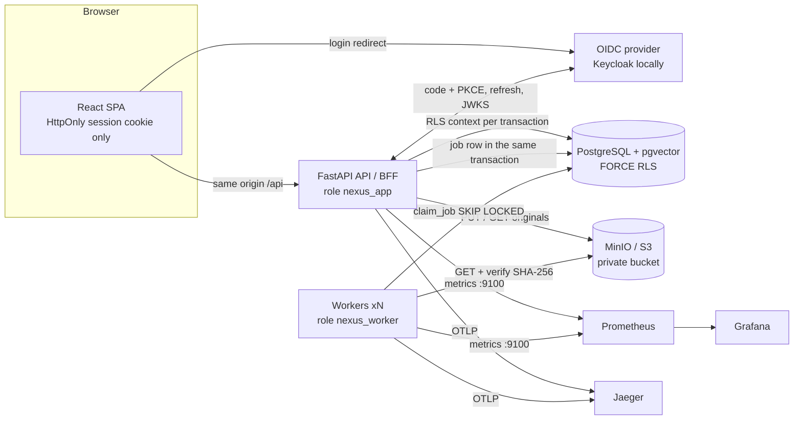

# Phase 4: enterprise hardening (v0.4.0)

Phase 4 adds the security and operations layers around the Phase 1-3 hybrid RAG and document
intelligence system, without changing their behaviour or their evaluation results.

| Area | Implementation | Design / evidence |
|---|---|---|
| 4A Authentication | OIDC Authorization Code + PKCE through the backend (BFF), HttpOnly cookie sessions, CSRF, strict JWT validation with JWKS rotation, identity → tenant / group / role mapping, revalidation, RP-initiated and back-channel logout; demo mode isolated and refused outside local environments | [authentication-oidc.md](authentication-oidc.md) |
| 4B Row-level security | FORCE RLS on 15 tables, runtime roles `nexus_app` / `nexus_worker` without BYPASSRLS, transaction-local security context, worker job scope, SECURITY DEFINER helpers | [postgresql-rls.md](postgresql-rls.md) |
| 4C Background processing | PostgreSQL-backed durable queue (SKIP LOCKED, leases, fencing tokens, backoff, dead letter, crash recovery), worker processes, job API, live status in the UI | [background-processing.md](background-processing.md) |
| 4D Storage and lifecycle | S3-compatible storage (MinIO / AWS) with server-generated keys, checksums, upload validation, versions, staged deletion + purge, retention, backfill / reconcile tools | [object-storage-lifecycle.md](object-storage-lifecycle.md) |
| 4E Observability | JSON logs with redaction, Prometheus metrics (low cardinality), OpenTelemetry traces across the queue, Grafana / Prometheus / Jaeger stack, liveness / readiness | [observability.md](observability.md) |
| 4F Verification | security regression suite, failure injection, k6 load profiles, component benchmarks, backup / restore drill, Docker end-to-end | [security-test-results.md](security-test-results.md), [performance-benchmarks.md](performance-benchmarks.md) |
| Operations | runbook: profiles, upgrades, backups, restore, failed jobs, re-indexing, incidents, rotation | [operations-runbook.md](operations-runbook.md) |

## System overview

## Compatibility

* Phase 1-3 API contracts are unchanged in inline mode; new fields are additive
  (`lifecycle_state`, `processing`, `current_version`, `owner_is_me`, `job` …). Queue mode returns
  **202** with a job for uploads, new versions, re-processing and re-indexing.
* Error bodies of authentication failures are objects `{"code", "message"}` (were strings).
* Document ids, chunk ids of existing documents, citations, embeddings, review history and audit
  data are unchanged by the migrations. A new **version** of a document gets new chunk ids (the
  document id stays), so citations of the old version stop resolving.
* `DEMO_MODE` remains as the legacy switch; it only chooses the default of `AUTH_MODE` and is
  refused outside local environments.
* The browser no longer stores a token (`localStorage` removed); the API still returns the demo
  bearer token from `POST /api/auth/login` for scripts.

## Definition of Done

The status of each item, with the evidence that supports it, is maintained in the final report and
in [phase4-progress.md](phase4-progress.md). "Complete" means complete against the Phase 4 scope,
not certified production readiness; see the limitations in each document and in
[phase4-case-study.md](phase4-case-study.md#what-remains-out-of-scope).
