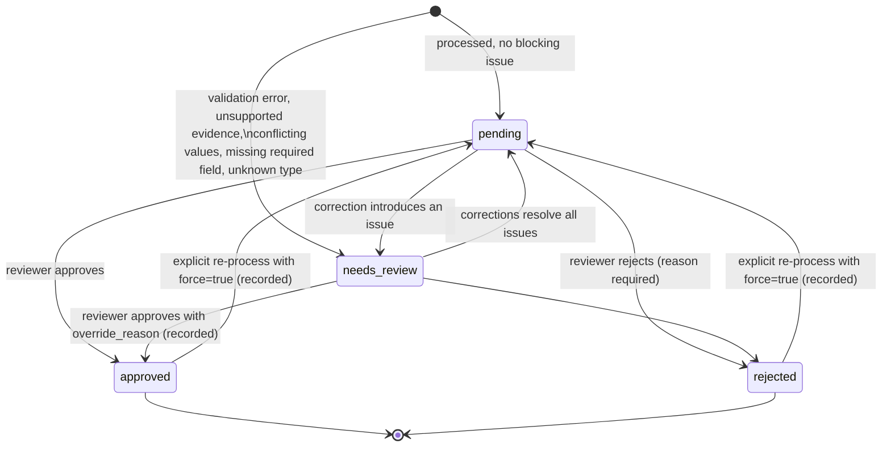

# Human-in-the-loop review (Phase 3)

Extracted fields are proposals. A person decides what becomes approved data, and every decision is persisted, attributed and auditable.

## Lifecycle

| Field state | Meaning |
|---|---|
| `ok` | value present, evidence supports it (`exact` / `normalized` / `reviewer_asserted`), no issue |
| `needs_review` | warning (e.g. conflicting values in the document) or unsupported evidence |
| `invalid` | at least one validation **error** |
| `missing` | no value |

## What a reviewer can do (API and UI)

1. Open a document: its normalized structure (pages, headings, paragraphs, tables with merged cells) and the extracted fields.
2. Inspect evidence. Clicking `p. N` scrolls to that page and highlights the verbatim line or table row. Coordinates are shown only when the parser produced them. For DOCX, XLSX and text files the UI says that evidence is located by page and text, not geometry.
3. Correct values: `PATCH /api/extractions/{id}/fields`.
   - Human-written values are normalized: `31.03.2026.` → `2026-03-31`, `2.080,00 EUR` → `2080.00`. An unparseable value gets HTTP 422.
   - An optional `evidence_quote` must exist in the document (otherwise HTTP 422).
   - A field the extractor missed can be added. A value can be cleared with `null`.
4. See validation warnings. Validation runs again on the corrected values after every change.
5. Approve: `POST /api/extractions/{id}/approve`. **Approval is blocked (HTTP 409, errors listed)** while validation errors remain, unless an `override_reason` of at least 10 characters is given. The reason is recorded as `OVERRIDE (n errors): ...`.
6. Reject: `POST /api/extractions/{id}/reject`. A reason is required.
7. View the history (`GET /api/extractions/{id}/history`): who did what, when, at which version, old → new value, and the comment.

## Provenance is never overwritten

A correction is stored **next to** the extracted value (`corrected_value`, `corrected_evidence`, `corrected_by`, `corrected_at`). The original value, its evidence and its grounding stay in the record, and the API returns both (`value` / `extracted_value`, `evidence` / `extracted_evidence`).

The corrected value is grounded too:
- against the reviewer's quote, or else the original evidence;
- if neither supports it, it is marked `reviewer_asserted`, meaning a person vouched for a value the document does not show verbatim.

## Concurrency

Every mutation carries `expected_version`. A stale version gets **HTTP 409** with the current version, so two reviewers cannot silently overwrite each other (optimistic locking). Each correction, approval and rejection increments the version.

## Authorization (server-side)

| Action | Rule |
|---|---|
| read structure, extraction, evidence, history | may read the document: same tenant AND (admin OR owner OR shared group). This is the RAG ACL (`security.authorized_documents`). |
| correct / approve / reject | may read the document AND role `reviewer` or `admin` |
| (re-)process | may read the document AND (reviewer / admin OR owner) |

- An extraction the user may not read gets **404**, exactly like a non-existent one. This holds even for review actions, so a stale-version 409 can never reveal that a forbidden extraction exists.
- A reader without the reviewer role gets 403 on review actions.
- The UI hides the review controls, but the rules are enforced by the API, not by the frontend.
- Every action writes a `review_events` row **and** a global `audit_events` row (`extraction_correct`, `extraction_approve`, `extraction_reject`, `extraction_process`, `extraction_reprocess`, `extraction_view`, `structure_view`).
- Neither table stores document text.

Demo personas: `reviewer@northstar.demo` (reviewer; procurement + finance + legal) and `procurement@northstar.demo` (member; read-only extractions).

## Measured (simulated review over the corpus)

`scripts/evaluate_docintel.py` replays a careful reviewer through the review API:
- it corrects every field to the ground truth;
- it tries to approve and, for documents that are invalid in the ground truth, checks that approval is **blocked**;
- it then rejects those invalid documents and the unknown ones, and approves the rest.

The report contains the correction rate, approval consistency (approved values = ground truth), the validation false-accept rate, blocked invalid approvals and the optimistic-lock check. See [extraction-evaluation-results.md](extraction-evaluation-results.md#human-review-simulated-through-the-review-api).

The simulation measures the workflow and the validation gate. It is not a study of human reviewers.
