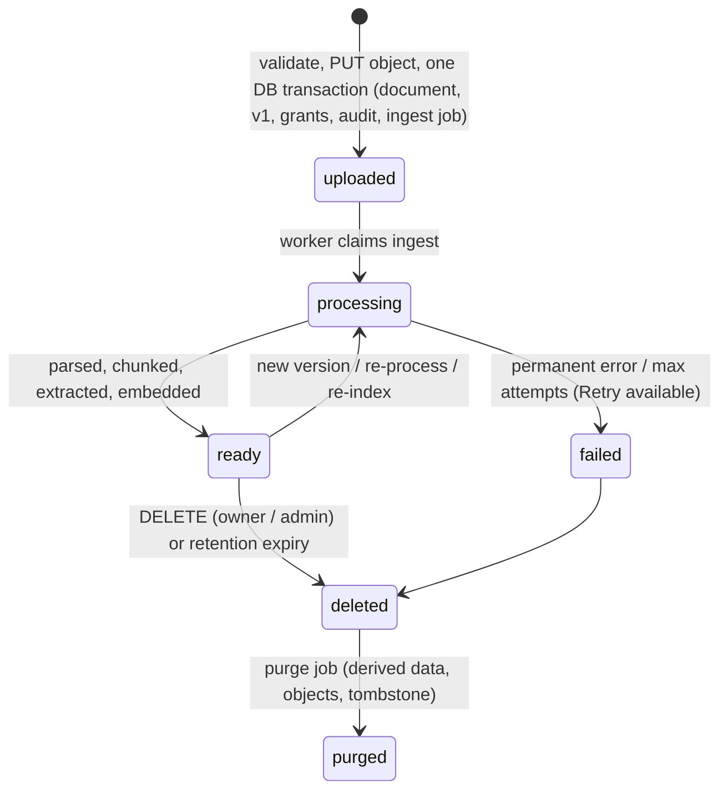

# Object storage and document lifecycle (Phase 4D)

## Storage

`backend/app/storage.py` provides one interface with two backends:

| Backend | Use | Notes |
|---|---|---|
| `s3` | Docker Compose (MinIO), AWS S3 or any S3 API | private bucket; `x-amz-checksum-sha256` verified by the server on upload; optional SSE (`S3_SERVER_SIDE_ENCRYPTION=AES256 | aws:kms`); bounded retries (`S3_MAX_ATTEMPTS`) and connect / read timeouts; path-style or virtual-hosted addressing |
| `local` | SQLite demos, unit tests, **legacy v0.1-v0.3 originals** | atomic writes (temp file + rename), refuses any key that resolves outside its root |

**Keys** are generated by the server only: `tenants/<tenant>/documents/<uuid>/v<n>/original`
(validated against a strict pattern before every call). No part of the user's filename or of any
request parameter reaches a key, so path traversal and key guessing across tenants are impossible
by construction; v0.3 local keys (`<document id>.<ext>`) remain readable.

**Uploads** are validated before anything is stored (`backend/app/uploads.py`): filename
normalisation, extension allowlist (PDF, DOCX, XLSX, TXT, MD; HTML, SVG, executables → 415), empty
(400), size (413, `MAX_UPLOAD_MB`), content sniffing against the extension (a "PDF" without `%PDF`, a
DOCX that is not an Office Open XML archive → 422), archive limits for DOCX / XLSX (declared
uncompressed size `MAX_UNCOMPRESSED_MB`, entry count, compression ratio, traversal member names →
zip-bomb protection), text files must be UTF-8 without NUL bytes. The stored `Content-Type` is
derived from the validated format, never from the client header.

**Downloads** are streamed by the API after the ACL check (`Content-Disposition: attachment`,
`X-Content-Type-Options: nosniff`, `Cache-Control: private, no-store`). With
`PRESIGNED_DOWNLOADS=true`, `GET /api/documents/{id}/download-url` returns a presigned GET URL valid
for `PRESIGNED_TTL_SECONDS` (60; max 900), issued **only after** the same authorization, signed
against `S3_PUBLIC_ENDPOINT_URL`. Off by default (MinIO is not published to the host).

**Least privilege (Compose)**: `minio-init` creates the private bucket and an access key whose
policy allows only `GetObject / PutObject / DeleteObject` on `nexus-documents/*` and `ListBucket`
on the bucket; the application never uses the MinIO root credentials. On AWS use an equivalent IAM
policy and block public access (`S3ObjectStore.ensure_bucket` sets the public-access block when the
API supports it).

**MinIO image.** The MinIO project stopped publishing community container images (Docker Hub and
Quay return "access denied" for `minio/minio`, verified 2026-11-15). Compose therefore uses
Chainguard's build of upstream MinIO (`RELEASE.2026-11-12T01-15-23Z`, AGPLv3) **pinned by digest**;
override with `MINIO_IMAGE` / `MINIO_CLIENT_IMAGE` (e.g. a self-built image) if that registry
policy changes. Only the S3 API is used, so any S3-compatible server works.

## Metadata

`documents` (current version): `storage_backend`, `storage_key`, `sha256`, `size_bytes`,
`content_type`, `current_version`, `lifecycle_state`, `created_at`, `updated_at`, `deleted_at`,
`deleted_by`, `purged_at`, `retention_until`. `document_versions`: one row per stored original
(`version`, backend, key, SHA-256, size, content type, original filename, `state`
stored → active → superseded / failed / purged, `created_by`, `object_deleted_at`).

## Lifecycle



| Operation | Endpoint | Rule |
|---|---|---|
| Upload | `POST /api/documents` (+ `Idempotency-Key`, `retention_days`) | grant only to own groups (admins: any) |
| View / text | `GET /api/documents/{id}` | reader |
| Download | `GET /api/documents/{id}/source`, `.../versions/{n}/source`, `.../download-url` | reader |
| Versions | `GET /api/documents/{id}/versions`, `POST /api/documents/{id}/versions` | read: reader; upload: owner / admin |
| Re-process | `POST /api/documents/{id}/process` | owner, reviewer, admin |
| Re-index | `POST /api/documents/{id}/reindex`, `POST /api/admin/reindex` | owner, reviewer, admin / admin |
| Retention | `PATCH /api/documents/{id}/retention` | owner / admin |
| Delete | `DELETE /api/documents/{id}` | owner / admin |

**New versions** keep the document id; chunks are rebuilt with new deterministic ids, so citations
of the old version's chunks stop resolving (document-level references stay valid). Older versions
stay downloadable until the document is purged. An approved extraction is re-processed for the new
content (recorded as `reprocess` in the review history).

**Deletion is staged.** (1) One transaction inserts the purge job and soft-deletes the document
(`nexus_rls.soft_delete_document`): from that commit on, the document, its chunks, embeddings,
extraction, fields, review history, versions and jobs are invisible to **every** query — through
the application ACL (`deleted_at IS NULL`) **and** RLS — so retrieval, citations, comparisons,
structured queries and downloads cannot return it (there is no result cache). Pending jobs of the
document are cancelled by the worker (`document_deleted`). (2) The purge job deletes derived data
(chunks → embeddings, tables, processing, extraction → fields, review events, grants) in one
transaction, then each stored object (idempotent; storage outage → retry), then writes the
**tombstone**: id, tenant, owner, checksum, timestamps, `deleted_by`, `purged_at`; title and
filename become `[deleted]`, extracted fields are emptied. `audit_events` (identifiers and actions
only) are retained. The purge refuses a document that is not soft-deleted.

**Retention**: `retention_days` at upload (or `DOCUMENT_DEFAULT_RETENTION_DAYS`, capped by
`DOCUMENT_MAX_RETENTION_DAYS`); the worker's sweep (`RETENTION_SWEEP_SECONDS`) calls
`nexus_rls.expire_documents()`, which soft-deletes expired documents, queues their purge and writes a
`document_expired` audit event (`deleted_by = system:retention`).

## Consistency without a distributed transaction

| Failure | Behaviour |
|---|---|
| Object PUT fails | 503, **nothing** in the database |
| DB transaction fails after the PUT | the object is deleted again (best effort); a leftover is an orphan that `scripts/storage_reconcile.py` reports and (with `--delete-orphans`) removes — only objects older than `--min-age-minutes` without a version row |
| Duplicate request | `Idempotency-Key` returns the original document (200); identical content without a key is a new document (`duplicate_of` in the response), each with its own object |
| Worker crash while processing | lease expiry → retry from the last committed checkpoint |
| Object unavailable at download | 404 "Original file missing" (missing) / 503 (storage down) |
| Object missing for a version row | reported by `storage_reconcile.py` as an integrity problem (never auto-fixed) |
| Partial deletion | each purge stage is idempotent; derived data first, then objects (each marked `object_deleted_at`), then the tombstone; retries resume |

## Migrating existing local originals

Migration `0006` does **not** move files: existing documents get `storage_backend='local'`,
`lifecycle_state='ready'` and a version-1 row pointing at the same local key; they keep their ids,
chunks, embeddings and citations. In Compose the old `document_storage` volume is mounted
**read-only**. Copy them into the bucket explicitly:

```bash
docker compose exec -T -e MIGRATION_DATABASE_URL=postgresql+psycopg://nexus:<pw>@db:5432/nexus api \
  python scripts/storage_backfill.py            # dry run: what would be copied
docker compose exec -T -e MIGRATION_DATABASE_URL=... api python scripts/storage_backfill.py --apply
```

Per version: read the local file → SHA-256 must equal the recorded checksum (else reported and
skipped) → PUT with server-side checksum → read back and compare → only then switch the rows to
`s3`. Resumable (rows already on `s3` are skipped); the **local files are never deleted or
modified** — remove the old volume yourself after verifying. Back up the database first
([operations-runbook.md](operations-runbook.md)).

## Verification

`test_storage.py` (keys, traversal, atomic writes, upload validation incl. zip bomb / mislabelled
files, MinIO: roundtrip, server-side checksum rejection, private bucket, presigned URL validity /
tampering / expiry / deleted object, outage → `StorageUnavailable`, API upload → MinIO key, download,
presign authorization, delete → object purged, outage at upload → nothing stored),
`test_jobs_lifecycle.py` (versions, deletion from every read path, purge result and tombstone,
retention expiry, reindex, DB failure after PUT → object removed), `scripts/e2e_phase4.py` and the
drills.
