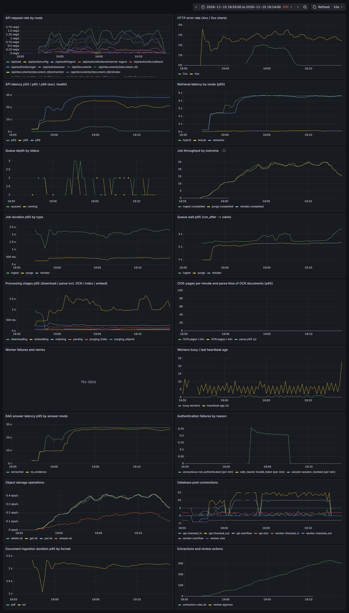

# Performance and load results (Phase 4)

Every number here was measured on one developer laptop under Docker Desktop. The numbers describe
this machine and this configuration; they are **not** capacity claims for production hardware.
Raw data: `eval/phase4/load/*.json` (k6 summaries as produced, never edited) and
`eval/phase4/benchmarks.json`. The dashboard screenshot below covers the same load window.

## Environment

| Item | Value |
|---|---|
| Host | Windows 10 Pro 22H2 (10.0.19045), Intel Core i7-1165G7 (4 cores / 8 threads, laptop), 64 GB RAM |
| Docker | Docker Desktop, engine 27.0.3, VM limited to 8 CPUs / 31.2 GiB |
| Stack | `compose.yaml` + `compose.oidc.yaml` + `compose.observability.yaml`: PostgreSQL 16 + pgvector, MinIO, Keycloak 26.4.2 (`start-dev`), one API container (one uvicorn process, FastAPI threadpool 40, DB pool 5 + 10 overflow), **one** worker, Prometheus / Grafana / Jaeger |
| Mode | `AUTH_MODE=oidc`, `PROCESSING_MODE=queue`, S3 storage (MinIO), RLS runtime roles, embeddings on CPU (`intfloat/multilingual-e5-small`), no LLM key (extractive answers) |
| Data | the seeded synthetic demo corpus (two tenants) plus the documents uploaded by the load test |
| Load generator | `grafana/k6:1.2.3` in a container on the Compose network (no published ports involved) |
| Image | `nexus-ai-backend:0.4.0-local` built from the working tree committed as `004cf47`–`93da418`. Two later changes do not touch the measured paths: the JWKS refresh error path and clamping of the pool-overflow gauge. |

## Load profiles (k6, `load/k6/nexus.js`)

| Profile | API scenario | Browser-login scenario |
|---|---|---|
| smoke | 2 VUs, 30 s | 3 logins |
| moderate | 10 VUs, 2 min | 6 logins / min, 2 min |
| stress | ramp 5 → 20 (1 min) → 40 (1 min), hold 40 (1 min), ramp down (30 s) | 12 logins / min, 3 min |
| sustained | 15 VUs, 8 min | 4 logins / min, 8 min |

Each API iteration (0–0.5 s think time) picks:
- 45 % a question (hybrid 5/8, semantic 2/8, lexical 1/8; Croatian and English, identifiers);
- 17 % the document list;
- 8 % a document detail;
- 6 % a download;
- 6 % a session check;
- 5 % a cross-tenant probe (northstar users);
- 5 % compare + extraction view (reviewer only);
- otherwise an upload, polling of its job until it finishes, and deletion of the document.

The users are five synthetic accounts in two tenants with different groups. API calls use
Keycloak access tokens (bearer, `aud=nexus-api`): each account logs in once and the VUs renew the
token with the refresh token. The login scenario runs the full browser flow (Authorization Code +
PKCE through the BFF, Keycloak login form, callback, cookie session check).

Authorization is checked **under load**. A source, list entry or answer that the user may not see
counts as an `authz_violation`; this threshold is zero for every profile. A cross-tenant probe
must answer 404.

## Results

| Profile | Started (UTC) | Wall time | Requests | Req/s | Failed requests | Checks | Authorization violations | Shed with 503 | k6 exit |
|---|---|---|---|---|---|---|---|---|---|
| smoke | 18:56:52 | 36 s | 115 | 3.3 | 0.00 % (0) | 100.0 % | 0 | 0 | 0 |
| moderate | 18:57:49 | 129 s | 590 | 4.7 | 0.00 % (0) | 100.0 % | 0 | 0 | 0 |
| stress | 19:00:20 | 215 s | 1033 | 4.8 | 3.48 % (36) | 96.6 % | 0 | 28 | 0 |
| sustained | 19:04:16 | 488 s | 2310 | 4.7 | 0.00 % (0) | 100.0 % | 0 | 0 | 0 |

| Operation | smoke p50 / p95 / p99 (n) | moderate p50 / p95 / p99 (n) | stress p50 / p95 / p99 (n) | sustained p50 / p95 / p99 (n) |
|---|---|---|---|---|
| `POST /api/ask` hybrid | 1 079 / 1 653 / 1 737 (20) | 6 049 / 10 936 / 13 429 (95) | 12 554 / 18 832 / 21 578 (183) | 9 110 / 14 682 / 17 436 (416) |
| `POST /api/ask` semantic | 1 211 / 1 384 / 1 405 (6) | 5 573 / 11 797 / 13 630 (45) | 12 625 / 20 880 / 21 882 (67) | 9 648 / 14 741 / 17 385 (161) |
| `POST /api/ask` lexical (FTS) | 468 / 821 / 853 (2) | 476 / 5 444 / 6 313 (20) | 6 818 / 13 984 / 16 306 (41) | 3 801 / 8 535 / 10 434 (82) |
| `GET /api/documents` | 82 / 257 / 286 (14) | 711 / 1 261 / 2 035 (58) | 2 975 / 10 090 / 10 457 (111) | 906 / 2 291 / 4 146 (269) |
| `GET /api/documents/{id}` | 62 / 102 / 106 (7) | 238 / 528 / 643 (25) | 1 768 / 8 254 / 9 630 (51) | 403 / 791 / 1 056 (128) |
| `GET …/source` (download) | 88 / 322 / 355 (4) | 248 / 678 / 752 (15) | 4 459 / 9 158 / 10 364 (32) | 401 / 840 / 1 019 (88) |
| `GET /api/auth/session` (bearer) | 18 / 60 / 69 (5) | 120 / 254 / 637 (21) | 3 595 / 7 434 / 10 127 (40) | 210 / 570 / 651 (93) |
| `POST /api/documents` (202) | 91 / 376 / 444 (6) | 375 / 896 / 1 025 (47) | 3 723 / 8 838 / 10 504 (95) | 605 / 1 178 / 1 517 (183) |
| `GET /api/jobs/{id}` | 28 / 47 / 47 (15) | 150 / 392 / 512 (123) | 1 760 / 8 427 / 10 075 (135) | 282 / 625 / 1 214 (405) |
| `DELETE /api/documents/{id}` | 88 / 101 / 104 (6) | 272 / 430 / 461 (47) | 2 982 / 10 014 / 10 304 (94) | 475 / 897 / 1 145 (183) |
| `POST /api/intelligence/compare` | – | 377 / 377 / 377 (1) | 1 719 / 3 869 / 4 019 (5) | 343 / 771 / 841 (23) |
| OIDC callback (code exchange) | 167 / 193 / 196 (3) | 476 / 1 167 / 1 384 (13) | 2 112 / 15 043 / 19 014 (26) | 672 / 1 554 / 1 593 (33) |
| Keycloak refresh grant | – | – | – | 66 / 143 / 145 (15) |
| Browser login through the BFF (4 requests incl. Keycloak form) | 542 / 572 / 574 (3) | 998 / 2 157 / 2 411 (13) | 2 299 / 22 578 / 25 776 (23) | 1 388 / 2 969 / 3 714 (33) |
| Job queue wait (created → started) | 612 / 930 / 947 (6) | 827 / 1 590 / 2 291 (47) | 822 / 2 154 / 2 896 (94) | 853 / 2 097 / 2 626 (183) |
| Job processing (started → finished) | 418 / 964 / 1 065 (6) | 625 / 1 610 / 2 822 (47) | 558 / 1 358 / 2 011 (94) | 622 / 1 535 / 2 765 (183) |
| Upload → job completed (client view, incl. polling) | 1 426 / 2 352 / 2 521 (6) | 2 089 / 3 416 / 4 036 (47) | 9 060 / 17 721 / 21 339 (94) | 2 265 / 4 268 / 5 490 (183) |

| Service | smoke CPU mean / max, memory max | moderate CPU mean / max, memory max | stress CPU mean / max, memory max | sustained CPU mean / max, memory max |
|---|---|---|---|---|
| api | 219 % / 391 %, 877 MiB | 462 % / 761 %, 1280 MiB | 450 % / 731 %, 2198 MiB | 463 % / 931 %, 1776 MiB |
| worker | 56 % / 110 %, 780 MiB | 87 % / 206 %, 820 MiB | 99 % / 352 %, 815 MiB | 82 % / 335 %, 796 MiB |
| db | 9 % / 14 %, 68 MiB | 32 % / 95 %, 129 MiB | 30 % / 58 %, 156 MiB | 30 % / 73 %, 156 MiB |
| keycloak | 8 % / 40 %, 871 MiB | 9 % / 79 %, 874 MiB | 12 % / 96 %, 876 MiB | 8 % / 100 %, 878 MiB |
| minio | 0 % / 1 %, 81 MiB | 1 % / 3 %, 82 MiB | 1 % / 4 %, 83 MiB | 1 % / 19 %, 84 MiB |

Jobs per profile (uploads that completed and were deleted again): smoke 6 (0 failed), moderate 47 (0 failed), stress 94 (0 failed), sustained 183 (0 failed).
Answered questions per second: smoke 0.78, moderate 1.24, stress 1.35, sustained 1.35.
Environment recorded by the runner: Docker 27.0.3, 8 CPUs, 31.2 GiB, Docker Desktop (containerized), grafana/k6:1.2.3.

The dashboard below shows the same window, 18:55–19:14 UTC, from the stack's own Prometheus. The
negative "overflow" values in the pool panel come from the build under test; that gauge is
clamped since `543ffde`.



### Findings

1. **No authorization failure under load.** All four profiles had 0 authorization violations
   across 4 048 requests: sources, lists, answers, and cross-tenant probes that always answered 404.
2. **`/api/ask` is CPU-bound and limits throughput.**
   - With one user, a hybrid answer takes 1.1 s at p50; FTS-only takes about 0.5 s.
   - The cost is query embedding plus sentence-level evidence scoring on CPU (`e5-small`).
   - With 10, 15 and 40 concurrent users, latency grows almost linearly with concurrency (p50 6 s,
     9 s, 12.5 s), while answered questions per second stay flat at about 1.3.
   - `docker stats` peaked at 731–931 % for the API container (100 % = one CPU; peaks above 800 %
     are sampling artefacts).
   - Scaling therefore needs more CPU, API replicas or a GPU / separate embedding service, not more
     threads.
3. **Saturation sheds load instead of failing.**
   - At 40 VUs the 15-connection pool was exhausted. Requests held connections while waiting for
     CPU, so 34 requests (3.3 %) were answered **503 + `Retry-After`**: 28 in the API mix and 6 in
     the browser-login scenario (API log).
   - The other 2 of the 36 failed requests are 401 session checks that followed two shed login
     callbacks.
   - Before the fix, the same condition produced HTTP 500; it was found by this profile and fixed
     in `543ffde`.
   - The stress profile has no 5xx other than these 503s, and no failed job.
4. **Background processing is not the bottleneck.** The single worker:
   - processed 330 upload jobs across the four profiles, all completed (0 failed, 0 retried);
   - kept queue wait at a p50 of 0.6–0.9 s and processing at a p50 of 0.4–0.6 s per document,
     even when the API was saturated.
   - During stress, the client-side "upload → completed" time grew because the API answering the
     uploads and the polling was slow; the worker itself stayed fast.
5. **Authentication overhead is small.**
   - A bearer session check takes 18 ms at p50 with one user. The full browser login through the
     BFF, including the Keycloak form, takes 0.54 s.
   - Keycloak's refresh grant takes 66 ms at p50.
   - Keycloak itself stayed below 1 CPU on average.
6. **Sustained load is stable over 8 minutes.**
   - 0 failed requests, flat latency (see the dashboard), API memory peaked at 1.8 GiB.
   - Eight minutes cannot rule out slow leaks; a longer soak test was not run.
7. **Found while load testing:**
   - Keycloak's brute-force quick-login check locks an account that logs in twice within a
     second. The k6 script logged accounts in concurrently and cached the error answer as a token.
     The script was fixed in `a67003e`; the API had correctly answered 401.
   - The JWKS cache was hardened in `004cf47`.

## Component benchmarks

`scripts/benchmark_phase4.py` ran inside the API image (Linux under WSL2, Python
3.12.16, 8 CPUs, Tesseract, the cached embedding model). It used a disposable
PostgreSQL 16 database on the test cluster, with a synthetic corpus of 600 documents /
2400 chunks in two tenants. Report: `eval/phase4/benchmarks.json` (2026-11-15 19:46 UTC).
Each cell has 60 measurements after 5 warm-up queries, from a single run on one machine.

### Row-level security overhead (same retrieval functions, same 65 queries per mode)

| Mode | Persona | Without RLS (superuser) p50 / p95 ms | `nexus_app` with RLS p50 / p95 ms | Difference at p50 |
|---|---|---|---|---|
| lexical | member (group grants) | 7.7 / 10.6 | 27.2 / 33.0 | +19.5 ms (+252 %) |
| lexical | tenant admin | 10.9 / 14.7 | 12.5 / 14.5 | +1.6 ms (+14 %) |
| semantic | member (group grants) | 3.9 / 6.0 | 13.4 / 16.6 | +9.5 ms (+244 %) |
| semantic | tenant admin | 5.3 / 6.6 | 8.7 / 17.8 | +3.4 ms (+64 %) |
| hybrid | member (group grants) | 26.8 / 33.5 | 45.5 / 54.7 | +18.8 ms (+70 %) |
| hybrid | tenant admin | 33.3 / 35.2 | 22.4 / 26.8 | -10.8 ms (-32 %) |

- **For group members, RLS costs +10 to +20 ms per retrieval query on this corpus**, 1.7–3.5×
  the SQL time without RLS. The policies evaluate the grant check, a hashed subquery through
  `SECURITY DEFINER` helpers, as security-barrier predicates in addition to the application ACL.
- Against the ~1 s per answer measured in the load tests, this is small. It grows with the number
  of documents a user can reach, so it **must be re-measured at production corpus sizes**.
- Candidate optimizations, not implemented: partial indexes per tenant, and grant arrays carried
  in the transaction context.
- For tenant admins the difference ranges from +14 % to +64 %. Hybrid retrieval is faster under
  RLS (−33 %), consistently across two runs: the policy's tenant predicate prunes the other
  tenant's rows before ranking.
- An earlier run drew different random queries for each cell and showed −51 % to +143 %, which
  was query-mix noise. The script now uses one paired query list per mode.

### Other components

| Component | Result |
|---|---|
| Session validation through the full ASGI stack (`GET /api/auth/session`) | cookie session 12.2 ms p50 (session row lookup + touch) vs demo bearer JWT 10.8 ms |
| Queue overhead (claim + complete, no handler work, 300 jobs) | 209 jobs/s with 1 thread, 200 jobs/s with 4 threads: ~5 ms per job, negligible against ~0.6 s of processing per document; parallel claimers add no throughput on one database node (commit-bound) |
| Embeddings (`multilingual-e5-small`, CPU, batch 32) | 24.2 passages/s; single query 23.9 ms p50 / 32.0 ms p95 |
| Parsing (Phase 3 corpus, p50 / p95) | PDF 33.8 / 73.2 ms (n=10), DOCX 26.9 / 28.1 ms (n=4), XLSX 10.7 / 92.0 ms (n=3), TXT 0.4 / 1.1 ms (n=4), MD 0.3 / 0.7 ms (n=3) |
| OCR (scanned PDFs, Tesseract eng+hrv with deskew) | 3022.5 / 5820.3 ms (n=8) per document; 2.93 s per scanned page (the earlier run on the same machine: 3.64 s, so expect about ±20 % between runs) |

## Failure-injection drill

`scripts/resilience_drill.py` injects real faults into the running stack: processes are killed,
containers are paused or stopped, two workers run at once. It uses the `compose.drill.yaml`
overlay:
- `JOB_LEASE_SECONDS=20`, so a killed worker's job is recovered within the drill;
- `REQUEST_TIMEOUT_SECONDS=10`, below the drill's 30 s client timeout.

Report: `eval/phase4/resilience-latest.json`, 19:40 UTC, **12 / 12 checks passed**.

| Scenario | Checks | Observed |
|---|---|---|
| A worker SIGKILLed during OCR (stage `parsing`) | job recovered after lease expiry, completed on attempt 2, no duplicate chunks or documents | recovery 25.7 s (20 s lease) |
| B PostgreSQL paused (`docker pause`: frozen, TCP still accepted) | readiness 503, API 503 without details, liveness 200, recovery without restarts | request answered in 12.5 s (bounded readiness + 10 s deadline), ready again 14.1 s after the pause began |
| C object storage stopped | upload 503 with nothing stored, readiness `object_storage: unavailable`, uploads work after restart | the 503 came from the 10 s request deadline: the S3 client's retries (3 attempts, 3 s connect timeout) take longer. With the default 60 s deadline the specific `storage_unavailable` 503 is returned (first run) |
| D two workers + concurrent duplicate submissions (8 documents × 2 simultaneous re-index requests) | one job per document, each executed exactly once | 16 answers → 8 jobs, all `completed` on attempt 1 |
| E document deleted while its ingest job runs | ingest cancelled, purge completed, nothing left | `cancelled/document_deleted`, 0 chunks |

The first run on the same day had **2 failures** that were real defects, fixed in the next
commit with tests:

1. **B:** with PostgreSQL frozen, readiness and API requests waited on pooled connections until
   the client gave up. libpq has no client-side query timeout, and a frozen server's kernel still
   accepts TCP.
   - Fix: readiness probes run concurrently, each bounded to 3 s, and the database probe uses a
     new connection with `connect_timeout`.
   - Fix: a request deadline answers 503 + `Retry-After` when no response has started.
2. **D:** "unfinished job? else enqueue" was not atomic. Two simultaneous requests for one
   document created two jobs (the sequential version of the check could not show this: a job
   finished within ~140 ms).
   - Fix: transaction-scoped advisory locks per document, and one tenant lock for tenant-wide
     re-indexing.
   - A mutation test removes the lock and fails, `[True, True]`, i.e. two jobs.

## Backup and restore drill

`scripts/backup_restore_drill.py` ran against the same stack and wrote
`eval/phase4/backup-restore-drill.json` at 19:42 UTC. **8 / 8 checks passed.**
- The restore goes into a **new** database and a **new** bucket; the live ones are not modified.
- The backup files stay in `./backups/`, which is gitignored.

| Step | Result |
|---|---|
| Backup | `pg_dump -Fc` (1.84 MB), `pg_dumpall --roles-only`, `mc mirror` of 31 objects. 2.2 s |
| Restore | `pg_restore` into `nexus_restore_drill`, objects into `nexus-documents-restore`. 5.3 s |
| Row counts | identical in all 12 application tables (e.g. 491 documents incl. tombstones, 536 chunks, 536 embeddings, 960 jobs, 4 698 audit events) |
| Schema and RLS | Alembic revision `0008_row_level_security`; RLS enabled and forced on 15 tables; the same 44 policies |
| Runtime role | `nexus_app` sees 0 rows without a security context and the same documents as the original with one |
| Objects | all 31 restored objects match their recorded SHA-256 |
| Embedding rebuild | all embeddings deleted in the restored database and regenerated from the persisted chunks (536 / 536 in 54.6 s). Maximum cosine distance to the originals: 2.2 × 10⁻¹³ |

## Reproduce

```bash
docker compose -p nexus-p4 -f compose.yaml -f compose.oidc.yaml -f compose.observability.yaml up -d --build
python scripts/run_load_test.py --profile smoke --project nexus-p4      # moderate | stress | sustained
```

`run_load_test.py` starts k6 on the Compose network and samples `docker stats` for the project's
containers only. It writes `eval/phase4/load/<profile>.json`. The `load-test.yml` workflow runs
the same script on demand (`workflow_dispatch`); it has **not** been executed on GitHub, because
nothing was pushed.
