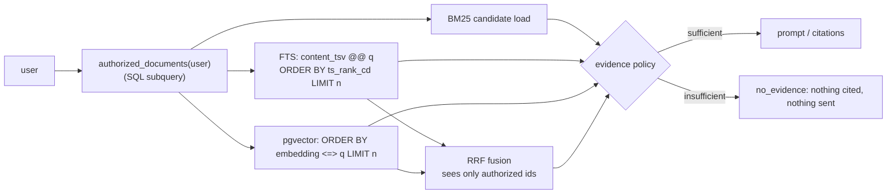

# Security model and verification

NEXUS AI is a **local demo**. Its identity layer is demo JWT auth and must not be deployed publicly (see ADR-004 in [architecture.md](architecture.md)). The retrieval authorization model, however, is designed and tested as if it were production-critical.

## Authorization rule

A user may read a document if it is in the same tenant **and** at least one of these holds: the user is an admin, the user is the owner, or the user shares at least one group with the document's grants. Documents without grants are visible only to their owner and tenant admins.

The rule is a single SQL subquery (`security.authorized_documents`). **Every** retrieval strategy puts it inside the same SQL statement that ranks and LIMITs chunks:

There is no global top-k followed by filtering, no retrieval cache and no reranker. A permission change therefore applies on the very next query.

## Verification layers

| Layer | What is checked | Where |
|---|---|---|
| Unit / API (SQLite **and** PostgreSQL) | tenant and group isolation, direct file routes, upload grants, audit scope | `test_permissions.py` (parametrized over both databases) |
| Vector space | forbidden chunks that are the *global* nearest neighbours never returned (top-k 1/3/10, API) | `test_pgvector.py` |
| Keyword + fusion | forbidden chunks that are the global #1 in **both** branches never enter FTS, semantic or hybrid results; 60 foreign chunks filling the global top-50 do not suppress authorized results | `test_hybrid_pg.py` |
| Dynamic permissions | grant, revoke and group membership change apply immediately; the owner rule is preserved | `test_hybrid_pg.py`, and again in the evaluation run |
| LLM context | the prompt sent to the LLM (captured with a fake client) contains only authorized chunk text, in all four modes | `test_hybrid_pg.py`, and over all 100 × 4 evaluation requests |
| Evidence policy | questions containing an identifier from a forbidden or non-existent document are refused (`identifier_not_found`) instead of answered from unrelated authorized text | `test_evidence.py`, `test_hybrid_pg.py`, evaluation |
| Answer extraction (Phase 2d) | the query-aware sentence selector and the sentence similarities of the evidence policy run only over the permission-scoped hits; quoted lines and `selected_sentences` are verbatim substrings of an authorized cited chunk; users without access to the Atlas agreement get no Atlas text for the same Croatian question; nothing is quoted when the policy abstains | `test_extractive.py`, `test_answers_pg.py`, evaluation (`quotes_not_verbatim_in_cited_chunk` = 0, zero-tolerance gate) |
| Evaluation oracle | every returned **and candidate** chunk (all 50 per branch) is checked against an **independent Python re-implementation** of the ACL rule, not the SQL used by the app | `backend/evaluation/corpus.py::Corpus.authorized`, `scripts/evaluate.py` |

**Mutation checks.** With `authorized_documents` temporarily replaced by an unscoped `select(Document)`, the vector-space test and all four keyword/fusion/permission/LLM security tests **fail**, so they detect real leaks.

## Measured results (full evaluation run, see benchmark-results.md)

All values below are generated by `scripts/evaluate.py` and are also enforced as zero-tolerance CI gates (`--ci`).

| Check | Result |
|---|---|
| Retrieval queries checked (100 questions × 4 modes) | 400 |
| Unauthorized chunks among returned + candidate chunks | **0** |
| Forbidden-evidence chunks retrieved for authorization questions | **0** |
| `/api/ask` responses checked | 400 |
| Unauthorized sources in responses | **0** |
| Unauthorized citations | **0** |
| Forbidden evidence text in answers or excerpts | **0** |
| LLM prompts captured and checked | 396 |
| Prompts containing text of an unauthorized chunk | **0** |
| Grant → visible, revoke → invisible (lexical, semantic, hybrid) | passed |

## Data handling in evaluation output and logs

- Reports (`eval/reports/*.json`, `*.md`, `/api/evaluation/summary`) contain metrics, chunk **IDs**, question texts from the dataset and timings, and **no document excerpts**. A test asserts that the summary endpoint contains no corpus text.
- The application does not log document content. Evidence diagnostics in API responses contain only the user's own identifiers and similarity values.
- The evaluation database name must end in `_eval` or `_test`, because it is dropped and re-created.

## Known gaps

- Authorization is enforced at the application SQL layer. There is no PostgreSQL row-level security yet (defense in depth for v0.4).
- Prompt injection inside authorized documents is mitigated only by the system prompt. No red-team suite exists yet.
- Demo authentication: HS256 JWT with shared demo passwords, no rate limiting, token stored in `localStorage`.
- No ANN index yet. Adding HNSW must come with filtered-recall tests, because index-first scans with post-filtering can silently lose authorized results.
